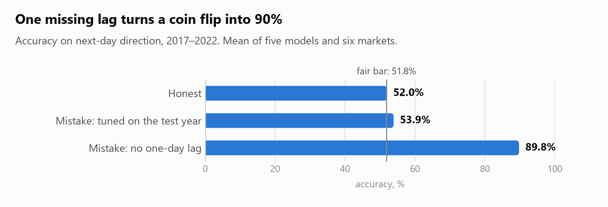
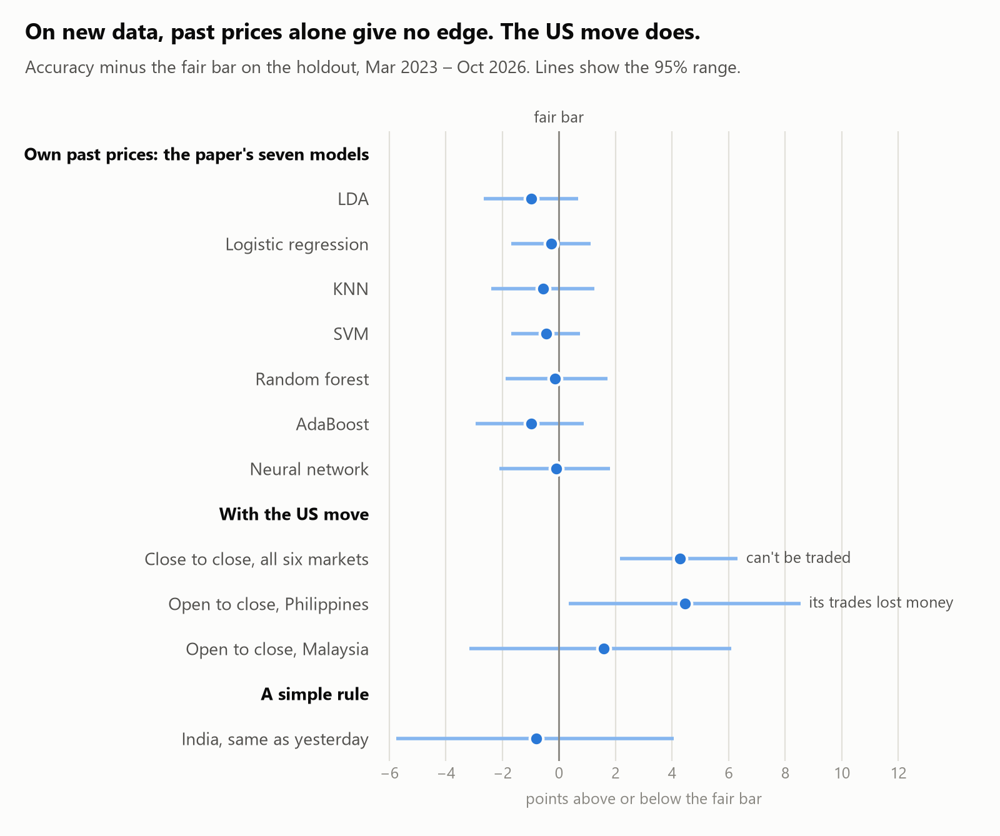
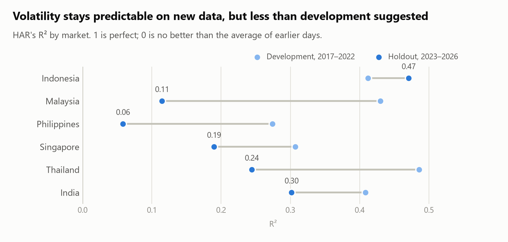

# asean-ml-forecasting

[](https://github.com/kesavakrishna/asean-ml-forecasting/actions/workflows/tests.yml)

**Can machine learning predict whether a stock index will go up or down tomorrow?**

Kumar & Thenmozhi (2006) reported 56–68% accuracy on India's Nifty using 12 technical indicators. This project re-tests that setup on the five ASEAN indices (Indonesia, Malaysia, the Philippines, Singapore and Thailand) plus the Nifty, with data from 2012 to 2026. The evaluation is built so that it can't cheat, and the final test used data that was opened only once.

## The short answer

- **From a market's own past prices: no.** Seven models score about 52%, the same as always guessing the more common direction (the "fair bar"). Adding 20 more standard indicators, or 777 automatic features from tsfresh, changes nothing (step 9).
- **From the overnight US move: yes, but it can't be traded.** On new data it gets 53–58% of close-to-close days right, against fair bars of 50–54%. By the time the market opens, the price already contains it.
- **Tomorrow's volatility: yes.** How big the move will be is predictable, and a three-number linear model (HAR) is at least as good as a random forest, GARCH and a GRU.
- **High scores are easy to get by mistake.** Remove one line, the one-day lag on the indicators, and five of those models go from 52% to 90%.



Every step's setup, tables and conclusions are in [findings.md](findings.md). The same story as a short article is in [blog.md](blog.md).

## The final test

The last three and a half years of data (17 Mar 2023 – 23 Oct 2026) were set aside from the start. Before they were opened, the tests and the expected results were written down and committed ([`87aa8d5`](https://github.com/kesavakrishna/asean-ml-forecasting/commit/87aa8d5)). Each test then ran once.

| Test | Expected before looking | Result |
|---|---|---|
| The paper's setup: seven models on a market's own past prices | No edge | **No edge.** Every model's range includes zero |
| The US move, close-to-close | Beats the fair bar | **Yes:** +4.3 points over six markets (range 2.2 to 6.3), but weaker than in development |
| The US move, open-to-close (the version you could trade) | Any edge stays below trading costs | **Worse than that:** the Philippines trades lost money before costs, and Malaysia's edge is gone |
| India: "same as yesterday" | Unsure | **Not real:** 52.9% against a fair bar of 53.7% |
| Volatility: HAR against "same as yesterday" and GARCH | HAR wins | **Yes.** Ahead of both in all six markets; the lead over GARCH is clear in four |
| Volatility: HAR against the GRU | HAR wins | **A tie** outside Thailand |
| Volatility: adding the US move to HAR | Adds a little | **No:** it adds nothing |

Two of the seven expectations were wrong. They're reported as they came out.





**A stricter second look, added afterwards.** The holdout has 123 significance tests, and with that many some pass by luck. Adjusting for that leaves 20 of the 36 significant results. The results in the table above already allow for it. The details are in [findings.md](findings.md#step-8-checked-more-strictly-added-after-looking).

## Why the numbers can be trusted

- **Walk-forward testing.** For each test year, a model trains on every year up to two years before, picks its settings on the year before, and is then tested. The features for a day use data only up to the day before.
- **A fair bar.** Every model is compared with always guessing whichever direction was more common before the test year, using a paired test.
- **A leakage test that proves it can fail.** `test_leakage.py` changes the future and checks that nothing computed for the past moves. It also plants leaks on purpose and checks that each one is caught. It runs on every push, on made-up data because the real data can't be shared.
- **A holdout opened once.** The plan was committed before the data was read, and nothing was changed after looking.
- **Mistakes made on purpose.** `common_mistakes.ipynb` shows what the two usual mistakes do to the score: tuning on the test year adds 1.9 points, and a missing lag gives 90%.

## What's in the repo

| File | What it is |
|---|---|
| `findings.md` | Every step's setup, tables and conclusions |
| `blog.md` | The project as a short article |
| `data.py` | `load_market()` / `load_all()`: load, clean and check the data, development period only unless asked. `load_us()`: the S&P 500. `load_other_moves()`: VIX, currencies and oil, with bad currency prints blanked (step 9). Every step after the EDA uses this |
| `download_data.py` | Downloads the four Yahoo markets and the S&P 500 into `Dataset/`, up to fixed end dates. `others` downloads VIX, the currencies and Brent oil (step 9) |
| `features.py` | Model features: the last 5 daily returns and yesterday's direction (step 3), the 12 technical indicators (step 4), the US move (step 5), return sequences (step 6), daily ranges, GARCH and the size of the US move (step 7), and step 9's three new sets (standard extras, tsfresh, other markets); the two labels (close-to-close, open-to-close) |
| `more_inputs.py` | Step 9: runs the seven models on the four sets of inputs, on the same days, with tsfresh's selection on training years only |
| `PLAN_more_inputs.md` | Steps 9 and 10's plan and expected results, committed before the runs |
| `evaluation.py` | Walk-forward splits, scoring (accuracy, balanced accuracy, MCC), no-model baselines, fair baseline, McNemar and Diebold-Mariano paired tests, Holm's adjustment for many tests, bootstrap ranges, money test |
| `models.py` | Logistic regression in sklearn and PyTorch, the walk-forward loop, per-year and pooled reports |
| `classifiers.py` | Step 4 models: the six sklearn classifiers, the PyTorch network, summary tables |
| `gru.py` | Step 6: the GRU network and its tuning |
| `volatility.py` | Step 7: the walk-forward loop for predicting a number, the GRU for ranges, GARCH, R², QLIKE and the paired test |
| `gru_probes.py` | Interpretability: reads the GRU's memory, compares it with an untrained GRU, and erases averages from it |
| `charts.py` | The shared look of the charts in `figures/` |
| `test_leakage.py` | Checks that nothing computed for day t changes when data after t is removed or scrambled, that features for day t don't use day t itself, and that the US feature doesn't use the US session dated t |
| `make_fake_data.py` | Writes made-up prices into `fake_data/`, so the leakage test can run without the real data |
| `walk_forward_baselines.ipynb` | Step 2: baselines scored on each test year |
| `logistic_regression.ipynb` | Step 3: both logistic regressions through the six folds, and the agreement check |
| `technical_indicators.ipynb` | Step 4: all seven models on the 12 indicators, a table per model, and the AdaBoost check |
| `common_mistakes.ipynb` | Step 4b: two common mistakes made on purpose, and what each does to the score |
| `us_overnight.ipynb` | Steps 5 and 5b: the US move as a feature, close-to-close vs open-to-close, the open-price check, and the checks of the two exceptions |
| `sequence_model.ipynb` | Step 6: GRU vs logistic regression on three tasks, and the random-seed check |
| `volatility.ipynb` | Step 7: HAR vs forest, GRU and GARCH, HAR + US, year by year, scores without 2020, HAR's weights, and the Indonesia fake-open check |
| `holdout.ipynb` | Step 8: all five one-shot tests on the holdout |
| `holdout_checks.ipynb` | Step 8, checked more strictly: adjusted p-values and ranges, from the saved holdout predictions |
| `gru_probes.ipynb` | Interpretability: the four questions about whether the GRU rediscovers HAR. Needs `volatility.ipynb`'s saved results |
| `more_inputs.ipynb` | Step 9: the four sets against each other and against the fair bar, what tsfresh kept, and two checks of set D added after looking |
| `figures/` | The charts on this page, saved by the notebooks |
| `results/` | Saved predictions, so a rerun skips finished work. Not in git. Delete the step 4b and step 7 files after changing a model. Keep the `holdout_*` files: they're the one-shot results |
| `requirements.txt` | The package versions the results were produced with |
| `llm_harness/` | A separate experiment: can a language model predict the next day, or does it remember? See its own README |
| `eda.ipynb`, `eda_report.md`, `eda_output/` | Step 1: the EDA on the original data, its write-up and its figures |

## Data

| Market | Index | Source | File in `Dataset/` |
|---|---|---|---|
| Indonesia | IDX Composite | Yahoo `^JKSE` | `Jakarta Composite (Yahoo).csv` |
| Malaysia | FTSE Bursa Malaysia KLCI | Yahoo `^KLSE` | `FTSE Bursa Malaysia KLCI (Yahoo).csv` |
| Philippines | PSEi Composite | Investing.com | `PSEi Composite Historical Data.csv` |
| Singapore | Straits Times Index | Yahoo `^STI` | `Straits Times Index (Yahoo).csv` |
| Thailand | SET Index | Investing.com | `SET Index Historical Data.csv` |
| India | Nifty 50 | Yahoo `^NSEI` | `Nifty 50 (Yahoo).csv` |

- **Coverage:** every market runs from 1 Jan 2012 to 23 Oct 2026. Thailand's last day is 22 Oct, because 23 Oct is a Thai holiday.
- **Development:** 1 Jan 2012 to 16 Mar 2023. Steps 1–7 and the interpretability work use only this, and their last test year is 2022.
- **Holdout:** 17 Mar 2023 to 23 Oct 2026. It was opened once, for step 8. `load_market()` leaves it out unless called with `include_holdout=True`. The two holdout notebooks, step 9 and the `llm_harness/` experiment do that. Since step 8 it counts as development data, and step 9 tests on 2017–2026.
- **US data:** S&P 500 from Yahoo `^GSPC`. 2010–2022 for development, plus a separate 2023–2026 file that only the holdout and step 9 read.
- **Other markets (step 9):** VIX (`^VIX`), each market's currency per US dollar (`IDR=X`, `MYR=X`, `PHP=X`, `SGD=X`, `THB=X`, `INR=X`) and Brent oil (`BZ=F`), closes only, 2010 to 23 Oct 2026, in `Other markets (Yahoo).csv`.

**Getting the data.** The data files aren't in this repo, for licensing reasons.
1. Run `python download_data.py`. It downloads the four Yahoo markets and the S&P 500 up to a fixed end date, so every run gets the same data. For step 9, also run `python download_data.py others`.
2. From Investing.com (free account), open the historical data pages for **PSEi Composite** and **SET Index**. Choose Daily, set 01/01/2012 to 10/23/2026, click Download, and save the files in `Dataset/` under the names above.

## Running

Tested with Python 3.13.

```
pip install -r requirements.txt
python download_data.py                       # then add the two Investing.com files (see Data)
python test_leakage.py
jupyter notebook walk_forward_baselines.ipynb
jupyter notebook logistic_regression.ipynb
jupyter notebook technical_indicators.ipynb   # about 25 minutes
jupyter notebook common_mistakes.ipynb        # about 20 minutes on a first run
jupyter notebook us_overnight.ipynb
jupyter notebook sequence_model.ipynb         # about 35 minutes
jupyter notebook volatility.ipynb             # about 20 minutes
jupyter notebook holdout.ipynb                # about 50 minutes on a first run
jupyter notebook holdout_checks.ipynb         # about 3 minutes; needs holdout.ipynb's saved results
jupyter notebook gru_probes.ipynb             # under 10 minutes; needs volatility.ipynb's saved results
python more_inputs.py                         # step 9: about 1.5 hours, plus 30 minutes for tsfresh's features on a first run
jupyter notebook more_inputs.ipynb            # about 15 minutes; needs more_inputs.py's saved results
```

**No data?** `python make_fake_data.py` writes made-up prices to `fake_data/`. Set the `DATA_DIR` environment variable to `fake_data` and the code runs on them. The results mean nothing, but it shows that everything works.

## Licence

The code is under the MIT licence (see `LICENSE`). The data isn't included, and stays under its providers' terms.
