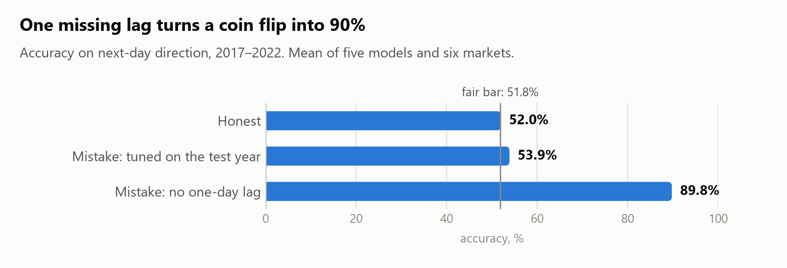
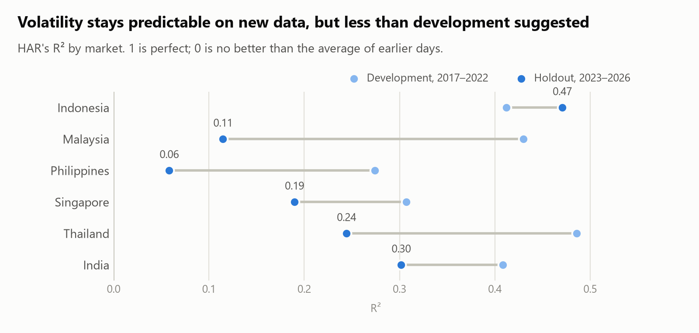

# One missing line took my stock model from 52% to 90%

I tested whether machine learning can predict if a stock index will go up or down tomorrow. The honest answer was about 52%, which is a coin flip. Then I removed one line of code, and the same models scored 90%.

This post is about that gap: what is really predictable in these markets, what isn't, and how to tell the difference.

## The claim I set out to test

A 2006 paper by Kumar and Thenmozhi reported 56–68% accuracy on India's Nifty index. It used 12 technical indicators, which are numbers like momentum and RSI computed from past prices.

I re-tested that setup on six markets: Indonesia, Malaysia, the Philippines, Singapore, Thailand and India, with data from 2012 to 2026.

## Four rules I set before modelling

1. **Test like real life.** For each test year, the model trains only on earlier years, and its settings are picked on the year before. It never sees the year it's tested on.
2. **Beat a fair bar.** Markets go up a little more often than down, so "always say up" already scores about 52%. A model has to beat that, not 50%.
3. **Test the code for leaks.** A leak is when information from the future slips into the inputs. My test changes the future prices and checks that nothing computed for the past moves. It also plants leaks on purpose, to prove it can catch them.
4. **Lock away the last three and a half years.** I didn't look at 2023–2026 until every decision was made.

## What I found

**Past prices don't predict direction.** Seven models on the 12 indicators scored about 52%, level with the fair bar. A neural network that reads the last 20 days in order (a GRU) did no better.

**The US market does, but too late to trade.** Add yesterday's move in the S&P 500 and accuracy rises to 58–61%. The catch is timing. The US closes after Asia does, so the news arrives overnight, and the Asian market *opens* at a price that already includes it. If you buy at the open and sell at the close, the edge is almost gone. The one market where it survived, the Philippines, earned about 0.1% per trade, which is less than it costs to trade.

**Volatility is predictable, with three numbers.** I switched from "which way?" to "how big will tomorrow's move be?" That one works. The best model was also the simplest: a straight line on the average size of the moves over the last 1, 5 and 22 days. It's called HAR. It beat a random forest and the classic GARCH model, and the neural network couldn't beat it either.

## Then I made two mistakes on purpose

My 52% looked bad next to the paper's 56–68%, so I wanted to know what it takes to get a high score.

**Mistake 1: tune on the test year.** Every model has settings. If you pick the ones that score best on the test year itself, accuracy rises by about 2 points. That's small, but it made 8 of 30 results look like a real, statistically significant edge. The honest version had none. This is the mistake the original paper made.

**Mistake 2: forget the one-day lag.** To predict whether today closes up, the indicators must stop at yesterday. Drop the lag and they include today's close, which is the answer itself. Momentum, for example, becomes today's close minus the close four days ago. Accuracy jumps to between 84% and 93% in every market, depending on the model.

The big mistake is the safe one. Nobody believes 90%, and my leak test catches it at once. The small one is dangerous: 54% looks like a modest, believable edge, and no test of the inputs can catch it. Only keeping the tuning year separate from the test year does.

## The final test

Before opening the locked-away data, I wrote down what I expected from each test and committed it to the repository. Each test ran once.

Most of it held:

- **Past prices:** still no edge. Every model's range includes zero.
- **The US move:** still real, at 4.3 points above the fair bar across the six markets, and still not tradeable.
- **The Philippines:** the tradeable version was still more accurate than the fair bar (53.4% against 49.0%), and yet its trades lost money even before costs. Being right more often isn't the same as making money, because a few big losses can outweigh many small wins.

Some of it didn't:

- **Volatility was harder to predict than I'd thought.** HAR still worked, but its score fell in five of the six markets.
- **The neural network caught up.** It had been clearly worse than HAR on the earlier data. On the new data they were about tied.
- **One idea failed.** Adding the size of the US move to HAR had helped a little before. On new data it added nothing.

Afterwards I made one more check. The final test contained 123 significance tests, and with that many, some pass by luck. After adjusting for that, 20 of the 36 "significant" results remained. None of the conclusions above changed, but several got less certain.

## A neural network that didn't need training

HAR and the neural network scored about the same, so I looked inside the network to see whether it had learned HAR's three averages.

At first it seemed so: I could read all three averages out of its memory quite accurately. But I could do the same with a network that had never been trained. The averages come with the network's structure for free.

An untrained network with only its last layer fitted scored higher than the fully trained one in five of six markets. Without that comparison, I would have reported a discovery that wasn't there.

## After the final test: more inputs, and markets I'd never looked at

The final test said the paper's 12 indicators had no edge. The obvious reply is "you didn't give the models enough". So I tried three bigger sets of inputs, writing down what I expected first:

- **20 more standard indicators** (MACD, Bollinger bands, ADX and others): no change.
- **777 automatic features** from a library called tsfresh: slightly worse. Its own filter found nothing worth keeping in 65 of 66 tries.
- **Other markets' moves the night before** (the S&P 500, the VIX "fear index", the currency and oil): 6 to 8 points better, close to close. Almost all of that is the US move again, and once more it's mostly gone by the open.

By then the final test was used up, and I'd chosen what to try after seeing it, so these weren't clean checks. For a clean one, I downloaded four markets I had never touched, Korea, Taiwan, Hong Kong and Japan, and ran everything once, unchanged. The pattern held. More indicators did nothing, and other markets helped even more, by 9 to 13 points. The size of that gain follows one number: how closely a market moves with the previous US session. Japan follows it most and gained most.

One more test is still to come, and it can't be rushed. I froze all 420 models on the data up to 23 October 2026 and put a fingerprint (a hash) of each in the repository. In late 2027 they'll be scored on a year of days that didn't exist when they were trained, so no choice I made can have seen them.

## What I learned

**About markets**

- **A market's own past didn't predict its direction.** Twenty more indicators and 777 automatic features changed nothing. More inputs made from the same prices gave the models more noise to fit, not more signal.
- **Outside information did, but it was already in the price.** The US move added 6 to 13 points, more in the markets that follow the US more closely. By the open it was mostly gone. "Predictable" and "tradeable" turned out to be different questions.
- **The size of a move was predictable when its direction wasn't.** Choosing a question that has an answer mattered more than choosing the model.

**About measuring**

- **Compare with a dumb baseline.** A model at 54% means nothing until you know that "always up" scores 52%. And "always up" is just owning the index, so matching it isn't beating the market; it *is* the market.
- **Being right more often isn't the same as making money.** The Philippines model was right more often than the fair bar and still lost money before costs.
- **Fear the small mistakes, not the big ones.** Nobody believes 90%. A believable 54% from tuning on the test year is the one that gets published.
- **Check the data, not only the model.** Stale opening prices made fake edges in three markets, and one currency series on Yahoo was broken for six years.
- **Compare with something that learned nothing.** An untrained network "knew" HAR's averages too.
- **Check what a model does, not what it says.** In a side experiment, a language model named the right rule in every late answer and then followed it only about half the time.

**About honesty**

- **Write your predictions down before you look.** Two of my seven were wrong. I only know that because they were written down.
- **Test data works once.** After the final test, every new idea was chosen after looking. New markets and new days were the only clean checks left, which is why one result is still a year away.
- **Test the code, not only the model.** A leak test that fails on a planted leak is worth more than another model.
- **A boring result you can trust beats an exciting one you can't.**

## For ML people

- **Honest feature selection keeps almost nothing.** tsfresh made 777 features, and its false-discovery control kept none in 109 of 110 training cutoffs. Run the selection on all the rows instead of the training rows, and they'd have looked useful. That's a leak.
- **Timing leaks hide in joins.** Joining another market's move by date silently uses the future when that market closes after yours. Join on "strictly earlier", and plant that exact mistake in your leak test to check that the test catches it.
- **When the signal is weak, simple models win or tie.** A three-input linear model matched or beat a forest, GARCH and a GRU on volatility. Logistic regression did as well as anything on direction.
- **Probes need a control.** An untrained GRU "contained" the same averages as a trained one, and with only its last layer fitted it scored higher in five of six markets. Random networks already compute useful features.
- **The base rate drifts.** How often days go up changes from year to year, so a model that leans the other way can beat the fair bar by luck. A "last year's direction" baseline showed that was most of two apparent edges.
- **Many tests make false wins.** Adjusting for 123 tests left 20 of 36 "significant" results. Comparing models on the same days with paired tests is far more sensitive than comparing two accuracies.
- **Accuracy, AUC and money disagree.** AUC showed the US move's gain more clearly than accuracy, and money showed that a more accurate model can still lose.
- **Run more than one seed.** The GRU's score moved noticeably between seeds.
- **Freezing is a tool.** A committed plan, plus a hash of each saved model, makes "I changed nothing after looking" something others can check.

## What I'd do better

**Data**

- **Use prices you can trade.** An index's opening number is partly stale, which made fake edges in three markets. Index futures or ETFs, ideally with intraday prices, would settle what can really be traded.
- **Score in money, with costs, from the start.** Accuracy was the main score for too long.
- **Check every series against a second source.** One of the currency series on Yahoo was broken for six years, and a pegged currency broke my bad-print rule.
- **Keep more than one sealed test set.** One holdout, once opened, left only new markets and new days for clean checks. Sealing a few markets and a final stretch of time at the start would have left more.

**Models and evaluation**

- **Plan the adjustment for many tests from the start.** I added it after the final test, and it took away 16 of 36 results.
- **Add a "recent direction" baseline next to the fair bar,** so drifting base rates can't pass for skill.

**The language models**

- **Try a frontier model, but only on days after its training data ends.** A bigger model would probably follow its own rule better. Its knowledge of past prices is also bigger, so the risk of it remembering instead of predicting grows too. I doubt it would find direction skill in past prices that no other model found, but whether it applies its own rule is a separate question, and a bigger model could change that answer.
- **Ask more questions.** The feedback test's differences were within 1.3 points, which is too small to tell apart with this many questions.
- **Look inside.** Interpretability work has found readable features in neural networks, from curve detectors in image models to a "Golden Gate Bridge" feature in a language model. Probing Gemma's and Llama's activations could show whether the model represents the rule it names and then overrides it with an "up" habit, or never really uses it. As with the GRU, it would need a control: the same probe on a model that wasn't given the rule.
- **Steer it.** A steering vector (the average activation when it answers "down" minus the average when it answers "up", added while it answers) could test whether the gap between its stated rule and its answer can be closed. That's a test of whether it can follow a rule. It wouldn't add market skill that isn't in the data, and any training on prices would have to keep the same walk-forward split.
- **Edit its weights directly.** A new MIT CSAIL report calls this weight-space programming: a frontier model reads a small network's weights and patches them, without training. It raised a small Qwen model's math score from 7.9% to 48.1% by editing 0.016% of its weights, mostly by ending its thinking loops. The report is unreviewed, but rule-following is the same kind of fault, so it's worth testing, against steering, a small fine-tune and a random edit.
- **Let it call a tool.** It failed at turning "down" into "up". Giving it a function that applies the rule would separate choosing a rule from carrying it out.

The code, the tests and every table are at [github.com/kesavakrishna/asean-ml-forecasting](https://github.com/kesavakrishna/asean-ml-forecasting).
