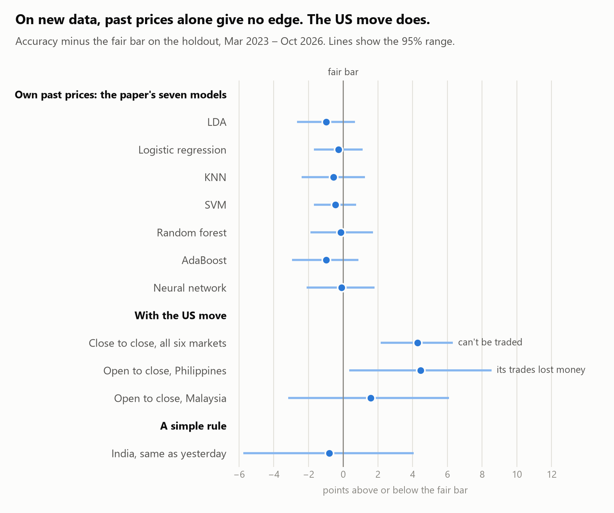

# One missing line took my stock model from 52% to 90%

I tested whether machine learning can predict if a stock index will go up or down tomorrow. The honest answer was about 52%, which is a coin flip. Then I removed one line of code, and the same models scored 90%.

This post is about that gap: what is really predictable in these markets, what isn't, and how to tell the difference.

## The claim I set out to test

A 2006 paper by Kumar and Thenmozhi reported 56–68% accuracy on India's Nifty index. It used 12 technical indicators, which are numbers like momentum and RSI computed from past prices.

I re-tested that setup on six markets: Indonesia, Malaysia, the Philippines, Singapore, Thailand and India, with data from 2012 to 2026.

## Four rules I set before modelling

1. **Test like real life.** For each test year, the model trains only on earlier years, and its settings are picked on the year before. It never sees the year it's tested on.
2. **Beat a fair bar.** Markets go up a little more often than down, so "always say up" already scores about 52%. A model has to beat that, not 50%.
3. **Test the code for leaks.** A leak is when information from the future slips into the inputs. My test changes the future prices and checks that nothing computed for the past moves. It also plants leaks on purpose, to prove it can catch them.
4. **Lock away the last three and a half years.** I didn't look at 2023–2026 until every decision was made.

## What I found

**Past prices don't predict direction.** Seven models on the 12 indicators scored about 52%, level with the fair bar. A neural network that reads the last 20 days in order (a GRU) did no better.

**The US market does, but too late to trade.** Add yesterday's move in the S&P 500 and accuracy rises to 58–61%. The catch is timing. The US closes after Asia does, so the news arrives overnight, and the Asian market *opens* at a price that already includes it. If you buy at the open and sell at the close, the edge is almost gone. The one market where it survived, the Philippines, earned about 0.1% per trade, which is less than it costs to trade.

**Volatility is predictable, with three numbers.** I switched from "which way?" to "how big will tomorrow's move be?" That one works. The best model was also the simplest: a straight line on the average size of the moves over the last 1, 5 and 22 days. It's called HAR. It beat a random forest and the classic GARCH model, and the neural network couldn't beat it either.

## Then I made two mistakes on purpose

My 52% looked bad next to the paper's 56–68%, so I wanted to know what it takes to get a high score.

**Mistake 1: tune on the test year.** Every model has settings. If you pick the ones that score best on the test year itself, accuracy rises by about 2 points. That's small, but it made 8 of 30 results look like a real, statistically significant edge. The honest version had none. This is the mistake the original paper made.

**Mistake 2: forget the one-day lag.** To predict whether today closes up, the indicators must stop at yesterday. Drop the lag and they include today's close, which is the answer itself. Momentum, for example, becomes today's close minus the close four days ago. Accuracy jumps to between 84% and 93% in every market, depending on the model.

The big mistake is the safe one. Nobody believes 90%, and my leak test catches it at once. The small one is dangerous: 54% looks like a modest, believable edge, and no test of the inputs can catch it. Only keeping the tuning year separate from the test year does.

## The final test

Before opening the locked-away data, I wrote down what I expected from each test and committed it to the repository. Each test ran once.

Most of it held:

- **Past prices:** still no edge. Every model's range includes zero.
- **The US move:** still real, at 4.3 points above the fair bar across the six markets, and still not tradeable.
- **The Philippines:** the tradeable version was still more accurate than the fair bar (53.4% against 49.0%), and yet its trades lost money even before costs. Being right more often isn't the same as making money, because a few big losses can outweigh many small wins.

Some of it didn't:

- **Volatility was harder to predict than I'd thought.** HAR still worked, but its score fell in five of the six markets.
- **The neural network caught up.** It had been clearly worse than HAR on the earlier data. On the new data they were about tied.
- **One idea failed.** Adding the size of the US move to HAR had helped a little before. On new data it added nothing.

Afterwards I made one more check. The final test contained 123 significance tests, and with that many, some pass by luck. After adjusting for that, 20 of the 36 "significant" results remained. None of the conclusions above changed, but several got less certain.

## A neural network that didn't need training

HAR and the neural network scored about the same, so I looked inside the network to see whether it had learned HAR's three averages.

At first it seemed so: I could read all three averages out of its memory quite accurately. But I could do the same with a network that had never been trained. The averages come with the network's structure for free.

An untrained network with only its last layer fitted scored higher than the fully trained one in five of six markets. Without that comparison, I would have reported a discovery that wasn't there.

## What I'd tell someone starting out

- **Compare with a dumb baseline.** A model at 54% means nothing until you know that "always up" scores 52%.
- **Test the code, not only the model.** A leak test that fails on a planted leak is worth more than another model.
- **Write your predictions down before you look.** Two of my seven were wrong. I only know that because they were written down.
- **A boring result you can trust beats an exciting one you can't.**

The code, the tests and every table are at [github.com/kesavakrishna/asean-ml-forecasting](https://github.com/kesavakrishna/asean-ml-forecasting).
