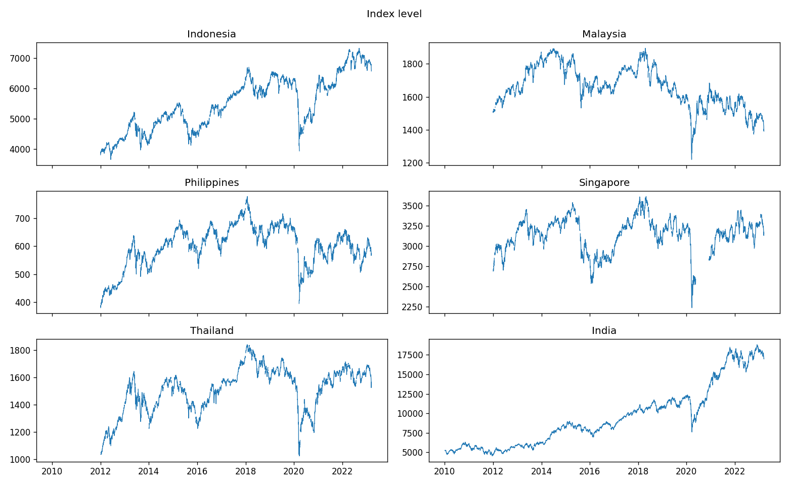
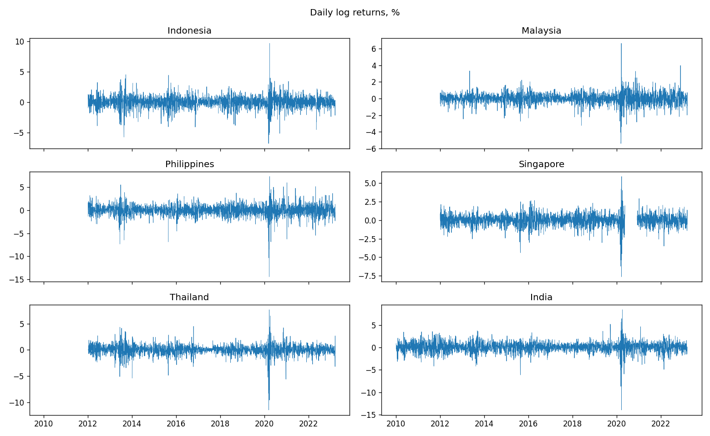
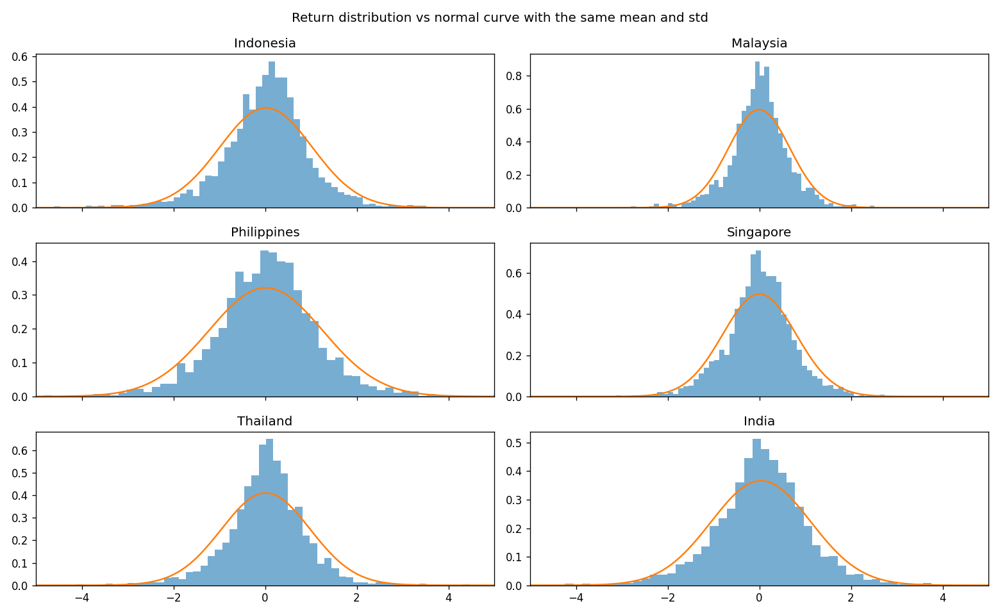

# EDA Report: ASEAN-5 (+ India) Stock Indices

**Data:** 6 daily index files in `Dataset/` (Investing.com exports)
**Code:** `eda.ipynb` (it also saves the figures below to `eda_output/`)

## Key findings

- The files hold raw daily index levels (Open/High/Low/Close), Jan 2012 – Mar 2023. The Philippines file has only real closing prices.
- There are three data problems: Singapore is missing May–Dec 2020, there are holiday/weekend filler rows, and Indonesia (8 rows) and Malaysia (1 row) have impossible High/Low values. The cleaning step handles all three. For now, Singapore's missing months are dropped.
- Returns have fat tails and are skewed to the downside. Yesterday's return tells you almost nothing about today's.
- 51–54% of days are up in each market, so the up/down classes are close to balanced.
- On a common test period (2021-01-01 onward), simple guessing scores **51.5–53.3% accuracy** in the ASEAN markets and **57.9% in India**. Balanced accuracy and MCC, which the up/down balance can't inflate, show the guesses have no real skill outside India.

---

## 1. What's in the files

| Market | Index | Rows | Start | End | O=H=L=C rows % |
|---|---|---|---|---|---|
| Indonesia | Jakarta Composite | 2,747 | 2012-01-02 | 2023-03-16 | 0.4 |
| Malaysia | FTSE Bursa Malaysia KLCI | 2,762 | 2012-01-03 | 2023-03-16 | 0.5 |
| Philippines | FTSE Philippines | 2,922 | 2012-01-03 | 2023-03-15 | 99.4 |
| Singapore | FTSE Straits Times | 2,695 | 2012-01-03 | 2023-03-16 | 0.9 |
| Thailand | SET Index | 2,732 | 2012-01-04 | 2023-03-16 | 0.0 |
| India | Nifty 50 | 3,277 | 2010-01-04 | 2023-03-16 | 0.0 |

- **Raw, unprocessed prices.** Each row is one day's index level: Open, High, Low, Close. There is no volume column and no adjusted close.
- **The date column mixes two formats** (`01-03-2012` and `03/15/2023`). Both are month-first.
- **O=H=L=C rows %** is the share of rows where all four prices are identical, which never happens on a real trading day.
  - Indonesia, Malaysia, Singapore: every such row is a holiday/weekend filler row that repeats the previous close.
  - Philippines: the file only records the close and copies it into Open/High/Low. 2,703 of these rows are real trading days and 201 are filler rows.
- **India is not an ASEAN market.** It's included as a benchmark and starts two years earlier.

## 2. Data quality

| Market | Duplicate dates | Weekend rows | Gaps > 5 days | Longest gap (days) | Unchanged closes | Longest frozen run | Bad OHLC rows |
|---|---|---|---|---|---|---|---|
| Indonesia | 0 | 10 | 11 | 12 | 14 | 2 | 8 |
| Malaysia | 0 | 12 | 3 | 6 | 18 | 1 | 1 |
| Philippines | 0 | 15 | 0 | 5 | 201 | 4 | 0 |
| Singapore | 0 | 0 | 1 | 202 | 23 | 1 | 0 |
| Thailand | 0 | 0 | 6 | 6 | 1 | 1 | 0 |
| India | 0 | 12 | 1 | 6 | 3 | 1 | 0 |

**Clean:**
- There are no duplicate dates.
- Prices never stay frozen for long stretches. The longest is 4 repeated days, over Philippine holidays.
- Every extreme daily move is real. They are concentrated in the March 2020 COVID crash, e.g. Philippines −14.5% on 2020-03-19 and India −13.9% on 2020-03-23.

**Problems and how they're handled:**

| Issue | Where | Handling |
|---|---|---|
| **Missing data:** 2020-05-19 → 2020-12-07 (202 days). Left in, it shows up as a fake +8.7% one-day return. | Singapore | Drop any return that spans a gap of more than 14 days |
| **Filler rows:** the same close as the day before, on holidays and weekends. Indonesia, Malaysia and the Philippines share the same 2014 weekend dates. | Mostly Philippines (201) | Drop rows whose close is unchanged from the previous day |
| **Impossible rows:** High below Open/Close, or Low above them. All are off by less than 0.5%. | Indonesia (8), Malaysia (1) | Widen High/Low so they contain Open and Close |
| **No daily range:** High = Low on every trading day, because only the close is real | Philippines (2,703) | Can't be fixed from this file. Indicators that divide by High − Low (e.g. the A/D oscillator) are undefined for this market |
| **Long closures:** 10–12 days around Eid. | Indonesia | Kept. Real market closures |
| **Weekend rows** | India (12) | Kept. Real special sessions (e.g. Budget day, Diwali Muhurat trading) |

After cleaning, the checks come back clean: no filler rows, no impossible rows, and the only weekend rows left are India's real sessions.

## 3. Returns

Daily log returns after cleaning, log(Close today / Close yesterday):

| Market | Days | Mean % | Std % | Ann. vol % | Skew | Excess kurtosis | Min % | Max % | Lag-1 autocorr |
|---|---|---|---|---|---|---|---|---|---|
| Indonesia | 2,732 | 0.020 | 1.01 | 16.0 | −0.26 | 7.0 | −6.8 | 9.7 | 0.047 |
| Malaysia | 2,743 | −0.003 | 0.67 | 10.6 | −0.18 | 8.5 | −5.4 | 6.6 | 0.016 |
| Philippines | 2,720 | 0.015 | 1.24 | 19.7 | −1.10 | 12.5 | −14.5 | 7.4 | 0.013 |
| Singapore | 2,670 | 0.003 | 0.80 | 12.7 | −0.58 | 9.3 | −7.6 | 5.9 | −0.022 |
| Thailand | 2,730 | 0.015 | 0.97 | 15.4 | −1.33 | 18.1 | −11.4 | 7.7 | −0.015 |
| India | 3,273 | 0.036 | 1.09 | 17.3 | −0.92 | 13.3 | −13.9 | 8.4 | 0.011 |

- **Drift is tiny compared with the noise.** The average daily return is a few hundredths of a percent, while the typical daily move is 0.7–1.2%.
- **Volatility differs by market.** Malaysia is the calmest (10.6% a year) and the Philippines the most volatile (19.7%).
- **Fat tails.** Excess kurtosis is 7–18, where a normal distribution would be 0. Extreme days happen far more often than a bell curve predicts.
- **Downside skew.** The big down days are larger than the big up days, most of all in Thailand, the Philippines and India.
- **Little day-to-day memory.** The correlation between today's and yesterday's return (lag-1 autocorrelation) is between −0.02 and 0.05.
- **Volatility clusters.** Calm and turbulent periods each last for a while: mid-2013, August 2015 and, above all, March 2020.

## 4. Share of up days (%)

| Year | Indonesia | Malaysia | Philippines | Singapore | Thailand | India |
|---|---|---|---|---|---|---|
| 2010 | – | – | – | – | – | 54.6 |
| 2011 | – | – | – | – | – | 43.3 |
| 2012 | 55.5 | 59.0 | 56.1 | 55.2 | 59.8 | 56.0 |
| 2013 | 54.5 | 53.4 | 57.3 | 53.8 | 53.9 | 50.4 |
| 2014 | 58.7 | 52.2 | 56.4 | 52.0 | 57.1 | 58.4 |
| 2015 | 52.5 | 48.0 | 53.8 | 46.4 | 45.7 | 48.8 |
| 2016 | 57.3 | 50.4 | 50.2 | 47.2 | 58.6 | 52.8 |
| 2017 | 55.9 | 51.9 | 55.6 | 51.2 | 56.0 | 56.3 |
| 2018 | 51.2 | 52.7 | 46.5 | 47.8 | 51.4 | 54.1 |
| 2019 | 52.7 | 46.3 | 52.1 | 50.8 | 49.2 | 53.1 |
| 2020 | 52.5 | 51.2 | 50.4 | 45.5 | 51.9 | 59.1 |
| 2021 | 53.0 | 49.4 | 52.4 | 54.5 | 53.5 | 55.6 |
| 2022 | 52.0 | 47.3 | 52.2 | 54.8 | 52.7 | 50.0 |
| 2023* | 50.9 | 38.8 | 47.1 | 39.2 | 36.5 | 38.5 |
| **All** | **54.1** | **50.9** | **52.9** | **50.9** | **53.3** | **53.0** |

\* 2023 covers January–March only.

- **Slightly more up days than down days overall.** Indonesia has the highest share and Malaysia and Singapore the lowest.
- **The share swings by year,** from about 46% to 60%. It fell below 50% in most markets in 2015 and early 2023.

## 5. How good is guessing?

These are three rules that predict whether today closes higher than yesterday without using any model:
- **Always up / always down:** predict the same direction every day.
- **Same as yesterday:** predict that today moves in the same direction as yesterday.

Every market is tested on the same days: **2021-01-01 to the end of the data**.

Each guess gets three scores:
- **Accuracy:** the share of days called right. The up/down balance can fool it. In Malaysia only 47.5% of test days were up, so "always down" scores 52.5%.
- **Balanced accuracy:** the average of the hit rate on up days and the hit rate on down days. Any constant guess scores exactly 50%.
- **MCC (Matthews correlation coefficient):** the correlation between guesses and outcomes, from −1 to 1. 0 means no skill.

| Market | Always up: accuracy | Always down: accuracy | Same as yesterday: accuracy | Same as yesterday: balanced acc. | Same as yesterday: MCC |
|---|---|---|---|---|---|
| Indonesia | 52.4 | 47.6 | 46.2 | 46.0 | −0.08 |
| Malaysia | 47.5 | 52.5 | 51.6 | 51.5 | 0.03 |
| Philippines | 51.9 | 48.1 | 49.5 | 49.4 | −0.01 |
| Singapore | 53.3 | 46.7 | 48.0 | 47.8 | −0.04 |
| Thailand | 51.5 | 48.5 | 51.3 | 51.3 | 0.03 |
| India | 51.5 | 48.5 | 57.9 | 57.8 | 0.16 |

The constant guesses always score 50% balanced accuracy and an MCC of 0, so those columns are left out.

**Bar to beat** (the best guess on each score):

| Market | Accuracy % | Balanced acc. % | MCC |
|---|---|---|---|
| Indonesia | 52.4 | 50.0 | 0.00 |
| Malaysia | 52.5 | 51.5 | 0.03 |
| Philippines | 51.9 | 50.0 | 0.00 |
| Singapore | 53.3 | 50.0 | 0.00 |
| Thailand | 51.5 | 51.3 | 0.03 |
| India | 57.9 | 57.8 | 0.16 |

- **In the ASEAN markets, guessing has no real skill.** Accuracy reaches 51.5–53.3% only because of the up/down balance. Balanced accuracy stays at 50–51.5% and MCC at 0.03 or below.
- **India's "same as yesterday" result is the strongest effect in the data.** It holds on balanced accuracy and MCC too, but treat it with caution until a second data source confirms it.
  - In the test period, the correlation between today's and yesterday's return is 0.056, higher than the full-sample 0.011.
  - Big moves don't explain it. Days that repeated yesterday's direction moved 0.78% on average, and days that reversed it moved 0.75%.
- **Report every model's accuracy, balanced accuracy and MCC** next to these numbers, on the same test period.

## Implications for modelling

- **Model returns or up/down direction, not price levels.** Price levels follow a trend, so even a simple guess scores well on them.
- **Apply the cleaning step before building features:** drop unchanged-close rows, widen High/Low to contain Open and Close, and drop returns that span gaps of more than 14 days.
- **Philippines:** with this file, use only features built from the close. Indicators that divide by High − Low won't work.
- **Use one calendar cutoff (2021-01-01) for every market, never a random split.** Report accuracy, balanced accuracy and MCC next to the baselines above.

## Open items

- **Philippines index:** this file is the FTSE Philippines index, not the PSEi; they are different indices. When extending the data, choose one. A PSEi source with real Open/High/Low data would also fix the close-only problem.
- **Singapore's missing months:** try to fill May–Dec 2020 from another STI source rather than dropping it. It covers the 2020 recovery, one of the most eventful stretches in the data.
- **India:** check the "same as yesterday" result against a second data source before relying on it.
- **Data range:** the data ends in March 2023. Consider extending it to the present.
- **Data source:** these files are Investing.com exports. Say so when describing the data (e.g. in the blog), whatever source the paper names.
