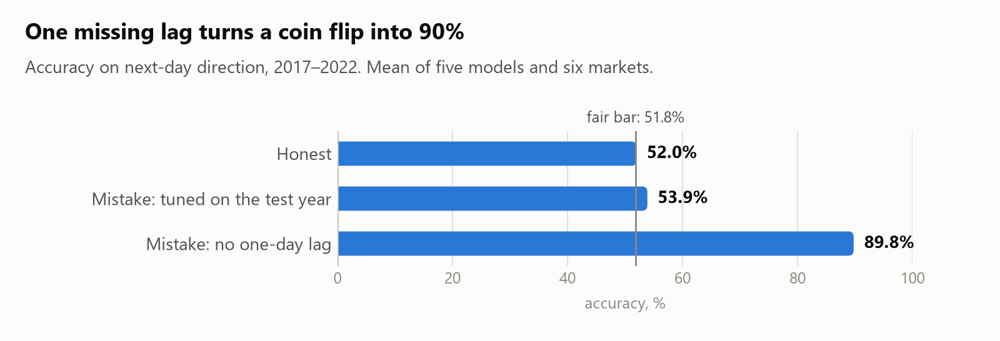
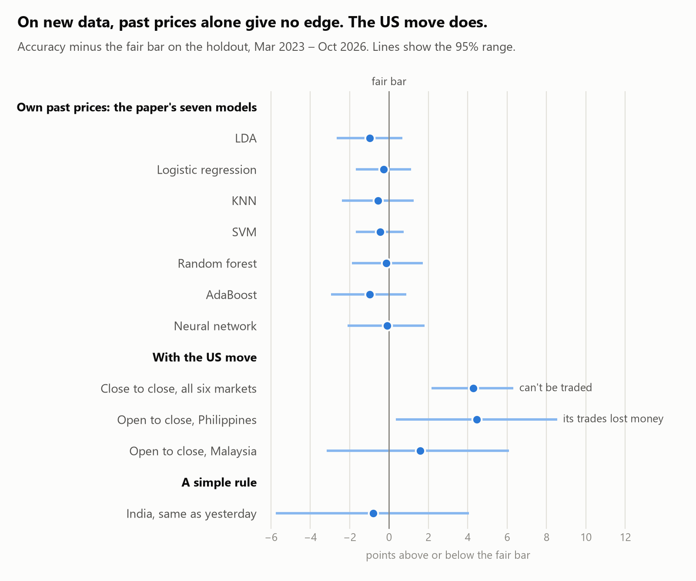
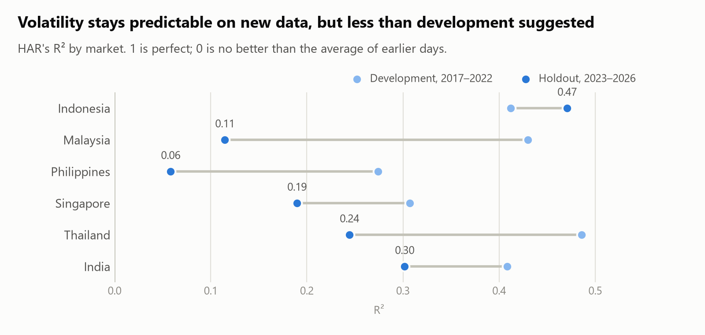

# Findings, step by step

The full results behind the [README](README.md), in the order the work was done. Each section gives the setup, the tables and what they show.

- [Data notes](#data-notes)
- [Step 2 findings: walk-forward baselines](#step-2-findings-walk-forward-baselines)
- [Step 3 findings: logistic regression](#step-3-findings-logistic-regression)
- [Step 4 findings: the paper's setup](#step-4-findings-the-papers-setup)
- [Step 4b findings: two common mistakes, made on purpose](#step-4b-findings-two-common-mistakes-made-on-purpose)
- [Step 5 findings: the US overnight move](#step-5-findings-the-us-overnight-move)
- [Step 5b findings: the two exceptions](#step-5b-findings-the-two-exceptions)
- [Step 6 findings: does a deep model change anything?](#step-6-findings-does-a-deep-model-change-anything)
- [Step 7 findings: volatility](#step-7-findings-volatility)
- [Holdout plan (committed in `87aa8d5` before opening the holdout)](#holdout-plan-committed-in-87aa8d5-before-opening-the-holdout)
- [Step 8 findings: the holdout](#step-8-findings-the-holdout)
- [Step 8, checked more strictly (added after looking)](#step-8-checked-more-strictly-added-after-looking)
- [Interpretability: does the GRU rediscover HAR?](#interpretability-does-the-gru-rediscover-har)
- [Step 9 findings: more inputs (added after looking)](#step-9-findings-more-inputs-added-after-looking)

## Data notes

The sources and the two periods are in the [README](README.md#data).

- **Checks made when switching sources:**
  - The original files were all from Investing.com and ended in Mar 2023. Over 2012 to Mar 2023, Yahoo matches them: the up/down direction agrees on 99.8–99.9% of days.
  - Yahoo also fills Singapore's missing May–Dec 2020.
  - The new SET file is identical to the original one.
  - The PSEi replaces the FTSE Philippines index used before. It's a different index, with real Open/High/Low data. Its daily returns correlate 0.976 with the old file's.
- **India second-source check:** "same as yesterday" scores the same in both sources (56.9% in 2021, 59.3% in 2022), so the persistence isn't a data error.
- Step 1 (the EDA) was done on the original Investing.com files, and `eda.ipynb` still reads those.

## Step 2 findings: walk-forward baselines

Every market is tested on six separate years. For test year Y: train on every year up to Y−2, tune on Y−1, test on Y. The table shows the accuracy of the best no-model guess ("always up", "always down" or "same as yesterday"), picked by looking at the test year. No model could know that in advance, so this is a **stretch bar**. Step 3 adds a fair bar that's fixed before each test year starts.

| Stretch bar, accuracy % | 2017 | 2018 | 2019 | 2020 | 2021 | 2022 | Range |
|---|---|---|---|---|---|---|---|
| Indonesia | 55.9 | 51.2 | 53.9 | 52.7 | 53.0 | 52.0 | 4.6 |
| Malaysia | 51.7 | 55.8 | 53.7 | 51.0 | 50.6 | 53.9 | 5.2 |
| Philippines | 56.4 | 53.5 | 51.0 | 52.3 | 51.4 | 53.1 | 5.3 |
| Singapore | 51.2 | 52.2 | 50.8 | 53.6 | 54.5 | 54.8 | 4.0 |
| Thailand | 56.0 | 51.8 | 51.6 | 51.9 | 53.5 | 56.0 | 4.4 |
| India | 56.3 | 53.9 | 53.1 | 58.8 | 56.9 | 59.3 | 6.2 |

- **The bar moves 4–6.2 points between years** in every market. The guess that sets it changes too; "always up" sets it most often.
- **One test year is noisy.** It has about 245 trading days, so one standard error is about 3.2 points. A model that beats the bar by less than about 6 points in a single year could be doing so by luck.
- **Pooling the six years cuts the noise** to about 1.3 points per standard error, so a pooled gap of about 2.6 points or more starts to mean something. These rules of thumb are for one accuracy on its own. From step 3 on, models are compared with a paired test instead (see below).
- **"Same as yesterday" has no consistent edge in the ASEAN markets.** Its MCC ranges from −0.17 to 0.12 and changes sign from year to year. In India it rises steadily, from 0.03 in 2017 to 0.19 in 2022.
- **All six markets pass the cleaning checks, and the leakage test passes.** The leakage test also fails on a planted leak, so it isn't passing by default.

## Step 3 findings: logistic regression

**Setup:**
- **Features:** the last 5 daily returns and yesterday's direction (+1/−1), all from the same market.
- **Folds:** in each fold, the scaler is fitted on the training years only. The penalty strength is picked by log loss on the tune year (Y−1), then the model is retrained on train + tune and tested on Y.
- **PyTorch version:** the same model as one `nn.Linear(6, 1)` trained with `BCEWithLogitsLoss` and weight decay. Its penalty is tuned separately from sklearn's.
- **Two bars:**
  - **Fair bar:** the direction that was more common in the years before the test year. It was "up" in every fold except Singapore 2021, where the training years had slightly more down days.
  - **Stretch bar:** the hindsight best guess from step 2.
- **Paired test:** the model and a bar are compared with McNemar's test, which only counts the days where exactly one of them is right.

All six test years pooled (sklearn):

| Market | Model accuracy % | MCC | AUC | Fair bar % | p vs fair | Same as yesterday % | p vs same as yesterday |
|---|---|---|---|---|---|---|---|
| Indonesia | 52.9 | 0.01 | 0.51 | 52.9 | 1.00 | 49.5 | 0.06 |
| Malaysia | 49.6 | −0.01 | 0.48 | 49.8 | 0.91 | 49.3 | 0.88 |
| Philippines | 51.4 | −0.04 | 0.51 | 51.8 | 0.15 | 48.4 | 0.11 |
| Singapore | 52.1 | 0.04 | 0.53 | 49.4 | 0.07 | 49.6 | 0.16 |
| Thailand | 52.1 | −0.06 | 0.50 | 52.4 | 0.06 | 51.0 | 0.57 |
| India | 53.8 | −0.01 | 0.54 | 54.6 | 0.28 | 54.8 | 0.59 |

- **No edge in the ASEAN markets.** Pooled accuracy matches the fair bar to within half a point everywhere except Singapore (+2.7 points, p = 0.07, not significant). AUC is 0.48–0.53, about what a coin flip scores (0.50).
- **The model often just says "up".** In 17 of 36 folds, tuning picked a penalty strong enough that the model calls every test day up. That's tuning's way of saying the features don't help. It happened in 5 of 6 folds for Thailand, and 4 of 6 for Malaysia and the Philippines.
- **No fold beats the fair bar significantly** (p < 0.05 in none of the 36). The model scores above the fair bar in 8 folds, below it in 11, and exactly matches it in 17.
- **India: logistic regression doesn't capture the direction persistence,** even though it's given yesterday's direction directly.
  - Pooled, it scores 53.8%, below both the fair bar (54.6%) and "same as yesterday" (54.8%).
  - In 2022 it's significantly worse than "same as yesterday": 49.2% vs 59.3%, p = 0.026. Of 117 days where they disagreed, the model was right on 46 and "same as yesterday" on 71.
  - A likely reason (not yet tested): the model learns one fixed weight from all years since 2012, when persistence was weaker, and tuning often picks heavy shrinkage.
  - **Read this with caution.** Pooled over six years, "same as yesterday" beats the fair bar by only 0.2 points (54.8% vs 54.6%), so the persistence is concentrated in recent years. India's test years have now been looked at several times, so a fix tailored to India risks fitting what's already been seen.
  - **Next:**
    - The second-source check is done; Yahoo agrees (see Data notes).
    - If a shorter training window is tried, run it on every market, not just India.
    - Treat "India's direction repeats" as an idea to confirm on the untouched holdout.
- **sklearn and PyTorch agree.**
  - With separately tuned penalties, predicted probabilities correlate at 0.993 or higher in all 36 folds, and up/down calls agree on 86.7–100% of days.
  - The lowest agreement is India 2022 (86.7%), Singapore 2018 (93.6%) and India 2020 (94.8%). The cause is that the two tuned penalties aren't equivalent: the grids only hold round numbers, so probabilities near 0.5 tip opposite ways.
  - Both versions leave the intercept unpenalised, so the intercept isn't the cause. In PyTorch the bias has its own parameter group with weight decay 0.
  - With the exact conversion, weight decay = 1 / (C × training days), PyTorch matches sklearn almost perfectly. Correlation is 0.99999 or higher, and the up/down calls agree on at least 99.6% of days in every fold.

## Step 4 findings: the paper's setup

**Setup:**
- **Features:** the 12 technical indicators from Kim (2003), as used by Kumar & Thenmozhi (2006): stochastic %K, %D and slow %D, momentum, rate of change, Williams %R, A/D oscillator, 5- and 10-day disparity, price oscillator, CCI and RSI. Look-back is 10 days (the papers don't say).
- **Models:** LDA, logistic regression, KNN, SVM, random forest and AdaBoost in sklearn, plus a neural network with one hidden layer in PyTorch.
- **Tuning:** each model tries a few settings and keeps the best on the tune year. The network picks its hidden nodes (2–12) and its number of epochs the same way, using early stopping.
- **Fixes the paper's mistake:** Kumar & Thenmozhi picked the SVM's settings and the network's hidden nodes by their score on the test period.
- **Skipped:** Kernel Factory, an R package with no standard Python version.
- **Data notes:**
  - The Philippines keeps all 12 indicators, because the PSEi file has a real High and Low. The old FTSE Philippines file had High = Low every day, so the A/D oscillator (which divides by High − Low) couldn't be computed.
  - Yahoo has 11 days with High = Low (Indonesia 5, Malaysia 6). The A/D oscillator is blank on those days, so the following day is left out.
- **Leakage test:** now also checks that the features for day t don't change when day t's own prices change. It passes, and it fails on a planted leak.

All 36 folds per model (6 markets × 6 test years):

| Model | Mean AUC | Folds above fair bar | Folds below | Significantly above | Significantly below | One-answer folds |
|---|---|---|---|---|---|---|
| LDA | 0.51 | 15 | 18 | 0 | 0 | 0 |
| Logistic regression | 0.52 | 11 | 7 | 0 | 0 | 16 |
| KNN | 0.51 | 17 | 14 | 2 | 1 | 4 |
| SVM | 0.51 | 12 | 10 | 0 | 0 | 7 |
| Random forest | 0.51 | 18 | 13 | 1 | 0 | 0 |
| AdaBoost | 0.52 | 16 | 18 | 0 | 0 | 2 |
| Neural network | 0.51 | 18 | 15 | 0 | 1 | 0 |

Pooled accuracy minus the fair bar, in points (the full table for each model is in `technical_indicators.ipynb`):

| Model | Indonesia | Malaysia | Philippines | Singapore | Thailand | India |
|---|---|---|---|---|---|---|
| LDA | 0.1 | −0.3 | 0.0 | 1.7 | −1.0 | −1.4 |
| Logistic regression | 0.2 | −0.3 | 0.3 | 1.0 | −0.1 | −0.1 |
| KNN | −0.1 | 1.8 | −1.2 | 3.3 | −0.1 | 0.3 |
| SVM | 0.0 | −0.1 | −0.5 | 0.7 | 0.0 | −0.1 |
| Random forest | −0.6 | −0.8 | 0.1 | 3.4 | 0.8 | −1.2 |
| AdaBoost | −1.5 | 0.8 | 0.3 | 1.5 | −1.6 | −0.1 |
| Neural network | −0.9 | 0.5 | −1.2 | −0.2 | 1.0 | −0.4 |

- **No model has an edge.** No pooled gap is significant; the smallest p-value is 0.06. Mean AUC is 0.51–0.52, where a coin flip scores 0.50.
- **The few significant folds look like luck.** Out of 252 model-folds, 3 beat the fair bar and 2 lost to it at p < 0.05. Testing that many folds, you'd expect a handful either way by chance.
- **Why Singapore looks best: its fair bar is weak, not its models strong.** Random forest is +3.4 points (p = 0.07) and KNN +3.3 (p = 0.06).
  - Most of the gain is in 2021 (+10 points), when the fair bar said "down" and the market rose on 54.5% of days. That "down" call was a near-tie: the training years had 1,120 up days and 1,122 down. With a few more early-2012 rows (as in step 5) it flips to "up".
  - Smaller gains come from 2018, a down year where "always up" scored badly.
  - MCC and AUC, which this can't fool, stay near a coin flip.
- **India:** the paper reported 56–68% on the Nifty for 2004–05. Here the same models score 53.1–54.8% for 2017–2022, while the fair bar scores 54.6% and "same as yesterday" 54.8%.
- **Giving one answer every day** (one-answer folds: all up, or all down): logistic regression did this in 16 of 36 folds, SVM in 7, KNN in 4 and AdaBoost in 2. LDA, random forest and the network never did. Only AdaBoost had an all-down year; the rest were all up.
- **AdaBoost doesn't win by saying "up".** It said up on every day in only 1 of 36 folds, and down on every day in 1 (both Thailand). Its accuracy was never significantly different from the fair bar (p ≥ 0.13), and its AUC ranged from 0.46 to 0.61. It simply has no edge.
- **AdaBoost tuning check:** with learning rates 0.1 and 1.0 only, 1.0 was picked in 33 of 36 folds, the top of the grid. With 2.0 and 4.0 added (and 500 estimators), 1.0 is picked 19 times, 2.0 9 times and 4.0 5 times. The scores barely move, and there's still no edge.
- **In one sentence:** once settings are no longer picked on the test period, and models are compared against a fair baseline, the paper's results disappear.

## Step 4b findings: two common mistakes, made on purpose

**Added after the holdout, on the development test years 2017–2022 only.** It uses step 4's indicators and five of its models (LDA is left out: it has no settings to tune), and makes one mistake at a time. Notebook: `common_mistakes.ipynb`.

- **Mistake 1, no one-day lag:** day t's indicators use day t's own close, which is the thing being predicted. In code it's one missing `.shift(1)`.
- **Mistake 2, tuning on the test year:** for each test year, keep the setting that scores best on that same year. This is the paper's mistake from step 4, here applied to every model.

Accuracy in %, mean over the six markets. The fair bar averages 51.8%:

| Model | Honest | Tuned on the test year | Without the lag |
|---|---|---|---|
| Logistic regression | 52.0 | 53.2 | 92.0 |
| KNN | 52.4 | 54.6 | 88.8 |
| SVM | 51.8 | 53.2 | 91.6 |
| Random forest | 52.1 | 53.8 | 90.5 |
| AdaBoost | 51.7 | 54.6 | 86.1 |
| **Mean of the five models** | 52.0 | 53.9 | 89.8 |
| Model-market pairs significantly above the fair bar, out of 30 | 0 | 8 | 30 |

Which indicators give the answer away? Logistic regression on one indicator at a time, without the lag, mean over the six markets:

| Indicator on its own, without the lag | Accuracy % |
|---|---|
| A/D oscillator | 85.7 |
| 5-day disparity | 75.3 |
| 10-day disparity | 67.4 |
| Stochastic %K | 66.3 |
| Williams %R | 66.3 |
| Momentum | 65.3 |
| CCI | 63.5 |
| RSI | 60.2 |
| Rate of change | 60.0 |
| Stochastic %D | 56.2 |
| Price oscillator | 53.2 |
| Slow %D | 52.8 |

- **Forgetting the lag takes every model from about 52% to 84–93%.** All 30 model-market pairs then "beat" the fair bar significantly. One indicator alone, the A/D oscillator, scores 86%.
- **Tuning on the test year adds 1.9 points on average** (0.3 to 3.8 across the 30 pairs). That's enough to make 8 of the 30 pairs look significantly better than the fair bar. The honest version has none.
- **The big mistake is the easy one to catch.** 90% is suspicious on sight, and the leakage test fails on it.
- **The small one is the dangerous one.** 54% looks like a modest, believable edge, and no test of the features can catch it. Only the fold design does: settings are picked on the tune year, which comes before the test year.
- **This doesn't show that any particular paper forgot the lag.** It shows that scores of 60–90% are what these mistakes produce, so a high score needs a leakage check before it's believed.

## Step 5 findings: the US overnight move

**Setup:**
- **Feature:** the S&P 500's daily return (Yahoo `^GSPC`, 2010–2022 only).
- **Timing:** the US session dated t ends after Asia has closed on day t. So Asian day t uses the last US session dated *before* t (Monday uses Friday). Joining on the same date would leak.
- **Leakage test:** removing or scrambling US data from day t onward doesn't change the feature for Asian days up to t. A same-date join fails the test, as it should.
- **Two targets:**
  - **Close-to-close**, as before. Not tradeable: the US move happens after Asia's previous close.
  - **Open-to-close.** Tradeable: see the US move, buy at the Asian open, sell at the close.
- **Models:** logistic regression and random forest, kept simple so the result is about the feature.
- **Fake opens:** on some days the open is just yesterday's close: Indonesia 2020 (45% of days) and 2022 (26%), Singapore 2012 (89%), the Philippines 2012–15 (about 6%). Those days are left out of the open-to-close target. Other years' opens are real.

How closely the US move lines up with each part of the Asian day (correlation):

| | Indonesia | Malaysia | Philippines | Singapore | Thailand | India |
|---|---|---|---|---|---|---|
| Close-to-close | 0.27 | 0.31 | 0.32 | 0.35 | 0.24 | 0.27 |
| Overnight gap (close → open) | 0.56 | 0.52 | 0.47 | 0.60 | 0.50 | 0.49 |
| Open-to-close | 0.06 | 0.05 | 0.12 | −0.03 | −0.09 | −0.03 |

Logistic regression, all six test years pooled:

| Market | Close-to-close % | Fair bar % | AUC | Open-to-close % | Fair bar % | p vs fair | AUC |
|---|---|---|---|---|---|---|---|
| Indonesia | 58.0 | 52.9 | 0.62 | 48.3 | 49.0 | 0.16 | 0.50 |
| Malaysia | 59.9 | 49.8 | 0.65 | 49.8 | 48.9 | 0.43 | 0.55 |
| Philippines | 60.5 | 51.8 | 0.64 | 55.9 | 50.2 | < 0.001 | 0.58 |
| Singapore | 61.4 | 50.9 | 0.66 | 49.4 | 49.8 | 0.42 | 0.48 |
| Thailand | 57.8 | 52.4 | 0.62 | 54.8 | 54.4 | 0.74 | 0.53 |
| India | 60.8 | 54.6 | 0.64 | 52.4 | 52.5 | 1.00 | 0.49 |

- **Close-to-close looks very predictable:** 58–61% accuracy and AUC 0.62–0.66. It beats the fair bar in every market (p < 0.001), and in 15 of 36 single years. But you couldn't trade it.
- **Open-to-close, the tradeable version, mostly loses it.** The open already absorbs the US move: it correlates about 0.5 with the overnight gap and about 0 with what follows. Four of six markets show no edge.
- **Two exceptions,** checked in step 5b below:
  - Philippines: 55.9% vs 50.2% (p < 0.001, AUC 0.58), with both models.
  - Malaysia: random forest only, 54.5% vs 48.9% (p = 0.002).
- Random forest gives the same picture (tables below).

**Full tables**, all six test years pooled. **One-answer folds** = test years (out of 6) where the model gave the same answer every day (all up, or all down).

**Close-to-close, logistic regression:**

| Market | Accuracy % | MCC | AUC | Fair bar % | p vs fair | Same as yesterday % | p vs same as yesterday | Called up % | One-answer folds |
|---|---|---|---|---|---|---|---|---|---|
| Indonesia | 58.0 | 0.15 | 0.62 | 52.9 | < 0.001 | 49.5 | < 0.001 | 76.8 | 0 |
| Malaysia | 59.9 | 0.21 | 0.65 | 49.8 | < 0.001 | 49.3 | < 0.001 | 62.1 | 0 |
| Philippines | 60.5 | 0.21 | 0.64 | 51.8 | < 0.001 | 48.4 | < 0.001 | 66.8 | 0 |
| Singapore | 61.4 | 0.23 | 0.66 | 50.9 | < 0.001 | 49.6 | < 0.001 | 53.7 | 0 |
| Thailand | 57.8 | 0.16 | 0.62 | 52.4 | < 0.001 | 51.0 | < 0.001 | 80.0 | 0 |
| India | 60.8 | 0.20 | 0.64 | 54.6 | < 0.001 | 54.8 | < 0.001 | 74.0 | 0 |

**Close-to-close, random forest:**

| Market | Accuracy % | MCC | AUC | Fair bar % | p vs fair | Same as yesterday % | p vs same as yesterday | Called up % | One-answer folds |
|---|---|---|---|---|---|---|---|---|---|
| Indonesia | 56.7 | 0.12 | 0.60 | 52.9 | 0.02 | 49.5 | < 0.001 | 63.3 | 0 |
| Malaysia | 61.0 | 0.22 | 0.64 | 49.8 | < 0.001 | 49.3 | < 0.001 | 54.7 | 0 |
| Philippines | 60.7 | 0.21 | 0.64 | 51.8 | < 0.001 | 48.4 | < 0.001 | 59.5 | 0 |
| Singapore | 61.4 | 0.23 | 0.65 | 50.9 | < 0.001 | 49.6 | < 0.001 | 48.2 | 0 |
| Thailand | 57.3 | 0.14 | 0.61 | 52.4 | 0.001 | 51.0 | < 0.001 | 68.8 | 0 |
| India | 60.6 | 0.20 | 0.63 | 54.6 | < 0.001 | 54.8 | 0.001 | 63.2 | 0 |

**Open-to-close, logistic regression:**

| Market | Accuracy % | MCC | AUC | Fair bar % | p vs fair | Same as yesterday % | p vs same as yesterday | Called up % | One-answer folds |
|---|---|---|---|---|---|---|---|---|---|
| Indonesia | 48.3 | −0.05 | 0.50 | 49.0 | 0.16 | 48.2 | 0.97 | 97.4 | 5 |
| Malaysia | 49.8 | 0.01 | 0.55 | 48.9 | 0.43 | 50.0 | 0.94 | 84.0 | 2 |
| Philippines | 55.9 | 0.13 | 0.58 | 50.2 | < 0.001 | 48.6 | < 0.001 | 70.3 | 1 |
| Singapore | 49.4 | −0.03 | 0.48 | 49.8 | 0.42 | 49.3 | 1.00 | 2.5 | 4 |
| Thailand | 54.8 | 0.05 | 0.53 | 54.4 | 0.74 | 48.0 | < 0.001 | 16.2 | 0 |
| India | 52.4 | −0.01 | 0.49 | 52.5 | 1.00 | 48.4 | 0.03 | 0.5 | 5 |

**Open-to-close, random forest:**

| Market | Accuracy % | MCC | AUC | Fair bar % | p vs fair | Same as yesterday % | p vs same as yesterday | Called up % | One-answer folds |
|---|---|---|---|---|---|---|---|---|---|
| Indonesia | 50.7 | 0.02 | 0.51 | 49.0 | 0.34 | 48.2 | 0.21 | 65.2 | 0 |
| Malaysia | 54.5 | 0.09 | 0.55 | 48.9 | 0.002 | 50.0 | 0.01 | 54.5 | 0 |
| Philippines | 56.0 | 0.12 | 0.57 | 50.2 | 0.001 | 48.6 | < 0.001 | 59.7 | 0 |
| Singapore | 49.2 | −0.02 | 0.49 | 49.8 | 0.75 | 49.3 | 0.97 | 41.7 | 1 |
| Thailand | 52.6 | 0.03 | 0.51 | 54.4 | 0.31 | 48.0 | 0.02 | 38.1 | 0 |
| India | 50.3 | −0.03 | 0.48 | 52.5 | 0.07 | 48.4 | 0.32 | 20.6 | 3 |

## Step 5b findings: the two exceptions

**The question:** do the Philippines and Malaysia open-to-close results come from something you could trade, or from how the index's opening number is recorded?

**The likely explanation:** the index's opening value only partly reflects the overnight US news. Some stocks haven't traded yet when it's recorded, so they still carry yesterday's price, and the rest of the news shows up after the open. The Philippines fits this: it has the weakest link between the US move and its open (0.47) and the strongest link after the open (0.12). The fake-open check can't catch this, because the open is only partly stale.

1. **Not a few huge days.** With 2020 removed from training, tuning and testing, the edge gets slightly *stronger*: Philippines 56.5% vs 50.1% (p < 0.001), Malaysia (random forest) 55.0% vs 49.1% (p = 0.003). The open-to-close correlations rise too (Philippines 0.12 → 0.19, Malaysia 0.05 → 0.11). Thailand's −0.09 barely moves (−0.08), so 2020 doesn't explain that one either.
2. **It's the US news arriving after the open.** With the market's own past returns instead of the US move, the edge disappears: 48.7–51.3% against fair bars of 48.9–50.2%.
3. **No tradeable price to test.** The Philippines' FMETF fund isn't on Yahoo. Malaysia's KLCI ETF (`0820EA.KL`) had no trades on 41% of days, and its open equals its close on 82%. I found no KLCI futures on Yahoo: its search returned nothing relevant, and the tickers I tried (`FKLI=F`, `FKLI.KL`, `KLCI=F`, `FBMKLCI=F`) returned no data.
4. **Money test, on the index:** buy at the open and sell at the close on days the model says up; otherwise stay out. Total over the six test years, at different round-trip trading costs:

| | Days in | Average day in % | No cost | 0.1% cost | 0.25% cost |
|---|---|---|---|---|---|
| Philippines, logistic regression | 1,027 of 1,461 | 0.09 | +128% | −18% | −83% |
| Philippines, random forest | 872 of 1,461 | 0.12 | +163% | +10% | −70% |
| Philippines, buy every day | 1,461 | | +3% | −76% | −97% |
| Malaysia, random forest | 796 of 1,460 | 0.05 | +43% | −35% | −80% |
| Malaysia, buy every day | 1,460 | | −11% | −79% | −98% |

**Average day in %** is the break-even cost: any round-trip cost above it wipes out the edge. For scale, the Philippine stock transaction tax on shares is 0.6% of each sale ([Inquirer](https://business.inquirer.net/?p=246692)). I couldn't confirm how it applies to ETFs.

**Verdict:** the edge comes from US news showing up in the index after its opening number is recorded, as you'd expect if the open is partly stale. Without a tradeable price we can't prove that. But it doesn't change the answer: even taken at face value, the edge is 0.05–0.12% per trade, less than realistic trading costs. It's not something you could trade.

## Step 6 findings: does a deep model change anything?

**Setup:** a small GRU in PyTorch reads the last 20 days in order, oldest first. Hidden size (8, 16 or 32) and epochs are picked on the tune year with early stopping. It's compared with logistic regression on the same days.

**Own returns only, close-to-close** (logistic regression gets the same 20 returns):

| Market | GRU % | Logistic regression % | Fair bar % | p GRU vs fair | GRU AUC |
|---|---|---|---|---|---|
| Indonesia | 53.6 | 52.7 | 52.9 | 0.24 | 0.52 |
| Malaysia | 47.9 | 49.6 | 49.8 | 0.23 | 0.49 |
| Philippines | 50.4 | 51.6 | 51.8 | 0.35 | 0.49 |
| Singapore | 46.8 | 50.6 | 49.4 | 0.16 | 0.47 |
| Thailand | 51.7 | 52.4 | 52.4 | 0.35 | 0.52 |
| India | 54.5 | 53.4 | 54.6 | 1.00 | 0.54 |

**With US data** (the GRU reads 20 days of own and US returns; logistic regression gets only the last US move, as in step 5):

| Market | Close-to-close: GRU % | Logistic regression % | p GRU vs LR | Open-to-close: GRU % | Logistic regression % | p GRU vs LR |
|---|---|---|---|---|---|---|
| Indonesia | 59.4 | 58.0 | 0.14 | 53.1 | 48.3 | 0.007 |
| Malaysia | 60.8 | 59.9 | 0.32 | 51.8 | 49.8 | 0.14 |
| Philippines | 60.5 | 60.5 | 1.00 | 55.7 | 55.9 | 0.90 |
| Singapore | 61.2 | 61.4 | 0.82 | 47.0 | 49.4 | 0.17 |
| Thailand | 58.1 | 57.8 | 0.83 | 52.8 | 54.8 | 0.21 |
| India | 60.2 | 60.8 | 0.66 | 53.5 | 52.4 | 0.39 |

**Random seeds, open-to-close.** The same GRU with four different starting points. **Average day in %** is what a trade earns on the index before costs:

| Market | GRU % | Fair bar % | Seeds with p < 0.05 | Average day in % |
|---|---|---|---|---|
| Indonesia | 50.1–53.1 | 49.0 | 2 of 4 | −0.04 to 0.00 |
| Malaysia | 49.7–51.8 | 48.9 | 1 of 4 | 0.00 to 0.03 |
| Philippines | 55.1–56.3 | 50.2 | 4 of 4 | 0.11 to 0.13 |

- **No, the deep model doesn't change the answer.** With own returns only there's still no edge: mean AUC is 0.50.
- **Where there is signal, one number gets almost all of it.** On close-to-close, the GRU reads 40 inputs and doesn't significantly beat logistic regression on the last US move alone.
- **Indonesia's open-to-close win over logistic regression isn't reliable.** It's significant for only 2 of 4 seeds, and those trades earn about nothing. Accuracy can rise without earning money.
- **The Philippines holds up across all seeds,** but it's the same edge as step 5: logistic regression matches it, and it earns about 0.12% per trade, which is below realistic costs.
- **Random seeds matter.** One market's accuracy moved by 3 points from the starting point alone, so a single run of a neural network can mislead.

## Step 7 findings: volatility

**Setup:** predict how big day t's move will be, not its direction. The target is the log of log(High / Low). Same six folds.

- **HAR:** linear regression on the average range over the last 1, 5 and 22 days.
- **Random forest:** the same three inputs.
- **GRU:** the last 20 daily ranges, three random seeds.
- **R²:** 1 is perfect, and 0 is no better than guessing the average of all earlier days.

**Is there anything to learn?** Correlation with one day earlier:

| Market | Direction | Range |
|---|---|---|
| Indonesia | −0.01 | 0.51 |
| Malaysia | 0.03 | 0.48 |
| Philippines | 0.02 | 0.40 |
| Singapore | −0.01 | 0.45 |
| Thailand | 0.02 | 0.54 |
| India | 0.08 | 0.44 |

**All six test years pooled** (R²; GRU shows the range over three seeds):

| Market | Same as yesterday | HAR | Forest | GRU |
|---|---|---|---|---|
| Indonesia | 0.167 | **0.412** | 0.356 | 0.395–0.401 |
| Malaysia | 0.136 | **0.430** | 0.389 | 0.339–0.356 |
| Philippines | −0.099 | **0.274** | 0.191 | 0.233–0.256 |
| Singapore | −0.061 | **0.307** | 0.199 | 0.169–0.244 |
| Thailand | 0.242 | **0.486** | 0.395 | 0.419–0.443 |
| India | 0.137 | **0.408** | 0.311 | 0.354–0.393 |

**HAR's R² by year:**

| Market | 2017 | 2018 | 2019 | 2020 | 2021 | 2022 |
|---|---|---|---|---|---|---|
| Indonesia | 0.46 | 0.21 | 0.20 | 0.63 | 0.32 | 0.24 |
| Malaysia | 0.39 | 0.25 | 0.03 | 0.69 | 0.32 | 0.32 |
| Philippines | 0.15 | 0.27 | 0.13 | 0.51 | 0.16 | 0.15 |
| Singapore | 0.12 | 0.16 | 0.07 | 0.62 | 0.05 | 0.10 |
| Thailand | 0.70 | 0.06 | 0.24 | 0.68 | 0.19 | 0.20 |
| India | 0.53 | 0.27 | 0.12 | 0.61 | 0.25 | 0.23 |

- **Volatility can be predicted; direction couldn't.** HAR beats both the average so far and "same as yesterday" in every market (p < 0.001 against "same as yesterday").
- **The simplest model wins.** HAR has the top R² in all six markets. The forest is significantly worse in all six (p ≤ 0.007) and beats HAR in only 1 of 36 market-years. The GRU is worse in all 18 market-and-seed runs, significantly in 15, and beats HAR in 11–14 of 36 market-years.
- **The pooled R² is flattered by unusual years.** 2020 is the best year in five of the six markets (0.51–0.69, Thailand's 0.68 just behind its 0.70 in 2017), but most other market-years are 0.05–0.32. HAR isn't much better in 2020; the average so far is just much worse. HAR's typical error is 0.46 that year against 0.39–0.42 in the others, while the average's is 0.76 against 0.42–0.53.
- **Weeks and months count more than yesterday.** HAR's weight on the 1-day average is 0.13–0.27; the 5- and 22-day averages get 0.27–0.40.
- **Indonesia's fake opens don't change the picture outside 2020.** Leaving them out moves R² only from 0.299 to 0.303 in the other five years. Across all years it falls from 0.412 to 0.320, because 2020's fake-open days score 0.734 against 0.418 for its real opens. So Indonesia's headline number leans on those 108 days, and 0.30 is the fairer figure.
- **This predicts the size of a move, not which way it goes,** so it isn't a trading signal on its own.

### Two more models and a second score

- **GARCH(1,1):** the classic volatility model, refitted before each test year. It forecasts the size of returns, so a straight line fitted on earlier years turns that into a range forecast.
- **HAR + US:** HAR plus the log size of the last US session's move, which is known before Asia opens.
- **QLIKE:** how far off a forecast is in relative terms, like "2× too high". Lower is better.

**R², all six years** (p is the paired test against HAR on squared errors):

| Market | HAR | GARCH | p | HAR + US | p | US weight |
|---|---|---|---|---|---|---|
| Indonesia | 0.412 | 0.314 | <0.001 | **0.420** | 0.018 | 0.046 |
| Malaysia | 0.430 | 0.386 | 0.004 | **0.434** | 0.004 | 0.030 |
| Philippines | 0.274 | 0.237 | 0.006 | **0.280** | 0.36 | 0.061 |
| Singapore | 0.307 | 0.294 | 0.53 | **0.325** | 0.001 | 0.053 |
| Thailand | 0.486 | 0.448 | 0.004 | **0.488** | 0.071 | 0.019 |
| India | **0.408** | 0.365 | 0.005 | **0.408** | 0.72 | 0.013 |

**R² without 2020** (GRU shows the range over three seeds):

| Market | HAR | HAR + US | GARCH | Forest | GRU |
|---|---|---|---|---|---|
| Indonesia | 0.299 | **0.303** | 0.175 | 0.261 | 0.273–0.293 |
| Malaysia | 0.278 | **0.282** | 0.232 | 0.243 | 0.265–0.277 |
| Philippines | 0.169 | **0.172** | 0.108 | 0.131 | 0.159–0.161 |
| Singapore | 0.098 | **0.115** | 0.091 | 0.067 | 0.059–0.081 |
| Thailand | 0.387 | **0.388** | 0.333 | 0.295 | 0.325–0.340 |
| India | **0.311** | **0.311** | 0.249 | 0.252 | 0.289–0.304 |

**QLIKE, all six years:**

| Market | HAR | HAR + US | GARCH | Forest | GRU |
|---|---|---|---|---|---|
| Indonesia | 0.477 | **0.463** | 0.644 | 0.551 | 0.489–0.501 |
| Malaysia | 0.575 | **0.568** | 0.615 | 0.650 | 0.741–0.771 |
| Philippines | 0.629 | **0.609** | 0.673 | 0.865 | 0.678–0.761 |
| Singapore | 0.378 | **0.354** | 0.362 | 0.521 | 0.452–0.560 |
| Thailand | 0.366 | **0.360** | 0.377 | 0.458 | 0.390–0.463 |
| India | 0.507 | 0.504 | 0.491 | 0.655 | **0.472**–0.583 |

- **HAR's win holds up without 2020.** Its R² still beats GARCH, the forest and every GRU seed in all six markets.
- **The US move adds a little.** HAR + US is never worse on R² and is best on QLIKE in five of six markets, but the R² gain is at most 0.018. Doubling the US move raises the predicted range by only about 1–4%. It's significant on squared errors in Indonesia, Malaysia and Singapore.
- **GARCH loses on R², but it's close on QLIKE.** It's worse on R² in all six markets, significantly in five. On QLIKE it beats HAR in Singapore and India, and only Indonesia's gap (HAR better) is significant.
- **India is the one QLIKE exception.** Two GRU seeds and GARCH beat HAR there, but none significantly, and the third seed is worse.
- **QLIKE isn't free of 2020 either.** It punishes forecasts that are too low much harder than ones that are too high, so 2020 costs some models a lot: the Philippines forest goes from 0.572 without 2020 to 0.865 with it.
- **R² here was already on the log of the range,** so a wild day never got extra weight for its size.

## Holdout plan (committed in `87aa8d5` before opening the holdout)

Each test runs once, on the code and settings as committed before opening. Same walk-forward rules as development: for test year Y, train up to Y−2, tune on Y−1, test on Y. Test years are 2023 (from 17 Mar), 2024, 2025 and 2026 (to 23 Oct). Nothing changes after looking, and every result gets reported, including anything that flips.

Direction tests are scored against the fair bar (the majority direction before each test year) with McNemar's test and AUC.

1. **The paper's setup:** all seven models on the 12 indicators, close-to-close, all six markets. Expect no edge.
2. **Close-to-close with the US feature:** logistic regression, all six markets. Expect it to beat the fair bar, though it can't be traded.
3. **Open-to-close with the US feature:** logistic regression for the Philippines, random forest for Malaysia, plus the money test at 0.1% and 0.25% costs. Expect any edge to stay below trading costs. These assume you could buy at the index's opening number, which may not be a real price.
4. **India, "same as yesterday" vs the fair bar:** close-to-close. Checks whether India's direction persistence is real.
5. **Volatility, all six markets:** HAR vs "same as yesterday", GARCH, the GRU (seeds 0, 1 and 2) and HAR + US. Each is scored on R² and QLIKE, with the paired test on both. Expect HAR to beat the first three on R², and HAR + US to add a little.

The US data for 2023–2026 is downloaded only when these tests run.

## Step 8 findings: the holdout

Each test ran once, as planned. After the plan was committed, the only code changes were to let the loops take other test years and to load the new US file. The development results still reproduced exactly afterwards. One check was added before looking: Indonesia's volatility without its fake-open days.

| Test | Expected | Result |
|---|---|---|
| 1. The paper's setup | No edge | **As expected:** no edge |
| 2. Close-to-close with the US move | Beats the fair bar | **Mostly:** above it in all six markets, significant in four, weaker than in development |
| 3. Open-to-close | Edge below costs | **As expected, and worse:** the Philippines trades lose money even before costs; Malaysia's edge is gone |
| 4. India, same as yesterday | Is it real? | **No** |
| 5. HAR vs same as yesterday and GARCH | HAR wins | **As expected** |
| 5. HAR vs the GRU | HAR wins | **Only just:** about a tie outside Thailand |
| 5. HAR + US vs HAR | Adds a little | **Not as expected:** no significant gain, and significantly worse in Indonesia |

### Test 1: the paper's setup

Over 24 market-years per model:

| Model | Mean AUC | Above fair bar | Below fair bar | Significantly above | Significantly below |
|---|---|---|---|---|---|
| LDA | 0.510 | 7 | 16 | 0 | 3 |
| Logistic regression | 0.515 | 5 | 11 | 0 | 1 |
| KNN | 0.510 | 9 | 14 | 0 | 1 |
| SVM | 0.509 | 6 | 10 | 0 | 1 |
| Random forest | 0.513 | 10 | 11 | 1 | 1 |
| AdaBoost | 0.516 | 12 | 11 | 0 | 1 |
| Neural network | 0.509 | 8 | 15 | 0 | 0 |

Accuracy minus the fair bar, in points, all test years pooled:

| Model | Indonesia | Malaysia | Philippines | Singapore | Thailand | India |
|---|---|---|---|---|---|---|
| LDA | −1.8 | 1.4 | 1.4 | −3.6 | −1.6 | −1.6 |
| Logistic regression | −0.8 | 2.0 | 1.5 | −3.6 | −0.8 | 0.2 |
| KNN | −0.5 | 0.7 | 0.2 | −2.6 | −0.9 | −0.1 |
| SVM | 0.0 | −0.5 | 0.3 | −3.1 | 0.2 | 0.3 |
| Random forest | −1.3 | 3.2 | 2.4 | −4.2 | −2.6 | 1.8 |
| AdaBoost | −4.7 | 1.8 | 0.7 | −2.4 | −1.1 | −0.2 |
| Neural network | −0.7 | 0.9 | 1.4 | −2.5 | −0.1 | 0.6 |

No model beats the fair bar significantly in any market over the whole holdout, and two fall significantly below it (AdaBoost in Indonesia, the random forest in Singapore).

### Test 2: close-to-close with the US move

| Market | Holdout % | Fair bar % | p vs fair | AUC | Development % | Development AUC |
|---|---|---|---|---|---|---|
| Indonesia | 56.7 | 52.2 | 0.008 | 0.58 | 58.0 | 0.62 |
| Malaysia | 57.7 | 50.3 | 0.001 | 0.62 | 59.9 | 0.65 |
| Philippines | 54.9 | 50.3 | 0.021 | 0.59 | 60.5 | 0.64 |
| Singapore | 57.7 | 54.4 | 0.14 | 0.62 | 61.4 | 0.66 |
| Thailand | 53.1 | 50.5 | 0.13 | 0.56 | 57.8 | 0.62 |
| India | 57.0 | 53.7 | 0.049 | 0.59 | 60.8 | 0.64 |

The link with the US move is real and it holds up on new data, but every market is weaker than in development. It still can't be traded.

### Test 3: open-to-close with the US move

| | Holdout % | Fair bar % | p vs fair | AUC | Average day in % | Development % | Development average day in % |
|---|---|---|---|---|---|---|---|
| Philippines, logistic regression | 53.4 | 49.0 | 0.044 | 0.56 | −0.03 | 55.9 | 0.09 |
| Malaysia, random forest | 51.6 | 50.1 | 0.53 | 0.54 | 0.03 | 54.5 | 0.05 |

Total return over the holdout:

| | Days in | 0.1% cost | 0.25% cost |
|---|---|---|---|
| Philippines, model | 503 of 876 | −48% | −75% |
| Philippines, buy every day | 876 | −83% | −95% |
| Malaysia, model | 459 of 883 | −28% | −64% |
| Malaysia, buy every day | 883 | −62% | −90% |

- **The Philippines is more accurate than the bar but makes no money.** Its 53.4% only just clears the significance line, and the days it calls up lose 0.03% on average before any costs. Accuracy doesn't guarantee profit: a few big moves can outweigh many small right calls.
- **Malaysia's edge is gone.**
- **The losses are smaller than buying every day mostly because the models trade less often.** Neither one makes money at either cost.

### Test 4: India, same as yesterday

Same as yesterday is right 52.9% of the time and the fair bar 53.7% (p = 0.77, over 886 days). India's direction persistence doesn't hold up.

### Test 5: volatility

**R²** (development HAR for comparison; GRU shows the range over three seeds):

| Market | Development HAR | Same as yesterday | HAR | HAR + US | GARCH | GRU |
|---|---|---|---|---|---|---|
| Indonesia | 0.412 | 0.222 | 0.471 | 0.462 | 0.367 | 0.462–0.474 |
| Malaysia | 0.430 | −0.345 | 0.115 | 0.113 | 0.040 | 0.094–0.116 |
| Philippines | 0.274 | −0.590 | 0.058 | 0.063 | 0.029 | 0.053–0.060 |
| Singapore | 0.307 | −0.251 | 0.190 | 0.195 | 0.137 | 0.170–0.184 |
| Thailand | 0.486 | −0.288 | 0.244 | 0.244 | 0.191 | 0.190–0.213 |
| India | 0.408 | −0.109 | 0.302 | 0.301 | 0.228 | 0.285–0.300 |

**p vs HAR on squared errors:**

| Market | Same as yesterday | HAR + US | GARCH | GRU seed 0 | Seed 1 | Seed 2 |
|---|---|---|---|---|---|---|
| Indonesia | < 0.001 | 0.029 | < 0.001 | 0.37 | 0.66 | 0.57 |
| Malaysia | < 0.001 | 0.75 | 0.022 | 0.17 | 0.12 | 0.90 |
| Philippines | < 0.001 | 0.60 | 0.12 | 0.66 | 0.73 | 0.90 |
| Singapore | < 0.001 | 0.52 | 0.044 | 0.15 | 0.66 | 0.61 |
| Thailand | < 0.001 | 1.00 | 0.017 | 0.008 | 0.016 | 0.078 |
| India | < 0.001 | 0.64 | 0.014 | 0.062 | 0.71 | 0.31 |

**QLIKE** (lower is better):

| Market | Same as yesterday | HAR | HAR + US | GARCH | GRU |
|---|---|---|---|---|---|
| Indonesia | 0.626 | 0.487 | 0.501 | 0.670 | **0.483**–0.509 |
| Malaysia | 0.715 | 0.460 | **0.455** | 0.498 | 0.468–0.504 |
| Philippines | 0.802 | 0.420 | **0.416** | 0.464 | 0.430–0.436 |
| Singapore | 0.493 | 0.327 | 0.317 | 0.351 | **0.314**–0.320 |
| Thailand | 0.557 | **0.321** | 0.322 | 0.366 | 0.357–0.373 |
| India | 0.840 | 0.489 | 0.489 | **0.437** | 0.485–0.489 |

**HAR's R² by year:**

| Market | 2023 | 2024 | 2025 | 2026 |
|---|---|---|---|---|
| Indonesia | 0.22 | 0.12 | 0.34 | 0.67 |
| Malaysia | 0.18 | 0.07 | 0.13 | 0.09 |
| Philippines | 0.06 | −0.00 | 0.14 | 0.02 |
| Singapore | −0.04 | 0.14 | 0.31 | 0.18 |
| Thailand | 0.02 | −0.02 | 0.42 | 0.33 |
| India | 0.55 | 0.08 | 0.31 | 0.29 |

- **Volatility is still predictable, but less so.** HAR beats same as yesterday everywhere (p ≤ 0.001 on both scores). Its R² falls in five of six markets, though, and sharply in Malaysia (0.430 to 0.115) and the Philippines (0.274 to 0.058, close to no skill against the average so far).
- **Indonesia is the exception, and it leans on one year.** Its 0.471 is pulled up by 0.67 in 2026; the other years are 0.12–0.34. Fake opens aren't the cause here: without those 107 days it's 0.484.
- **HAR still beats GARCH.** It has the higher R² in all six markets, significantly in five. On QLIKE it wins in five of six, significantly in four, with India going the other way (p = 0.21).
- **The GRU is now about tied with HAR.** In development it was significantly worse in 15 of 18 runs; here it's 2 of 18, both in Thailand. Three GRU runs have a slightly higher R², and none is significant. HAR is far simpler for the same accuracy, but "HAR beats deep models" is too strong: "a GRU doesn't beat HAR" is what this supports.
- **The US move didn't hold up.** HAR + US gained significantly in three markets in development, but here it gains nowhere and is significantly worse in Indonesia. The development gain wasn't reliable.

### What survives

- **Direction from a market's own history:** no edge in development or in the holdout.
- **The US link:** real but not tradeable, because the open already absorbs it.
- **Tradeable direction:** nothing that makes money after costs.
- **Volatility:** predictable, with HAR hard to beat, but less so than the development years suggested.

## Step 8, checked more strictly (added after looking)

These checks weren't in the plan, so read them as a stricter second look and not as new tests. They reuse the saved holdout predictions, and no model was run again. Notebook: `holdout_checks.ipynb`.

**Many tests.** The holdout has 123 significance tests, and with that many some pass by luck. Holm's method adjusts for this within each planned comparison: the smallest p-value is multiplied by the number of tests, the next by one fewer, and so on.

| Comparison | Tests | p < 0.05 as first reported | After adjusting |
|---|---|---|---|
| 1. Paper's models vs fair bar | 42 | 2 | 0 |
| 2. US move, close-to-close vs fair bar | 6 | 4 | 2 |
| 3. US move, open-to-close vs fair bar | 2 | 1 | 0 |
| 4. India, same as yesterday vs fair bar | 1 | 0 | 0 |
| 5. HAR vs same as yesterday, squared errors | 6 | 6 | 6 |
| 5. HAR vs GARCH, squared errors | 6 | 5 | 1 |
| 5. HAR vs GRU (3 seeds), squared errors | 18 | 2 | 0 |
| 5. HAR + US vs HAR, squared errors | 6 | 1 | 0 |
| 5. HAR vs same as yesterday, QLIKE | 6 | 6 | 6 |
| 5. HAR vs GARCH, QLIKE | 6 | 4 | 3 |
| 5. HAR vs GRU (3 seeds), QLIKE | 18 | 5 | 2 |
| 5. HAR + US vs HAR, QLIKE | 6 | 0 | 0 |
| **All comparisons** | 123 | 36 | 20 |

- **What holds:** nothing in the paper's setup beats the fair bar (its 2 significant results were both *below* the bar, and neither survives). HAR beats "same as yesterday" in all six markets on both scores.
- **The US move, close-to-close:** significant in two markets (Malaysia, Indonesia) instead of four.
- **The Philippines' open-to-close edge is no longer significant:** p goes from 0.044 to 0.088.
- **HAR vs GARCH:** five significant markets become one on squared errors (four others sit at 0.07–0.09), and four become three on QLIKE.
- **HAR vs GRU:** none of the 18 runs is significant on squared errors. On QLIKE two remain, both in Thailand.
- **HAR + US:** its one significant result (worse than HAR in Indonesia) goes too.

**Ranges.** How far each number could move by chance: whole weeks are resampled 2,000 times, and the range is the middle 95%. Whole weeks stay together because nearby days are related.

| Test | Model or market | Accuracy minus fair bar, points | 95% range |
|---|---|---|---|
| Paper's setup, all six markets | LDA | −1.0 | −2.6 to 0.7 |
| Paper's setup, all six markets | Logistic regression | −0.3 | −1.7 to 1.1 |
| Paper's setup, all six markets | KNN | −0.5 | −2.4 to 1.3 |
| Paper's setup, all six markets | SVM | −0.5 | −1.7 to 0.8 |
| Paper's setup, all six markets | Random forest | −0.1 | −1.9 to 1.7 |
| Paper's setup, all six markets | AdaBoost | −1.0 | −2.9 to 0.9 |
| Paper's setup, all six markets | Neural network | −0.1 | −2.1 to 1.8 |
| US move, close-to-close | All six markets | 4.3 | 2.2 to 6.3 |
| US move, close-to-close | Indonesia | 4.5 | 1.5 to 7.5 |
| US move, close-to-close | Malaysia | 7.4 | 3.0 to 11.4 |
| US move, close-to-close | Philippines | 4.7 | 0.8 to 8.5 |
| US move, close-to-close | Singapore | 3.3 | −1.2 to 8.0 |
| US move, close-to-close | Thailand | 2.6 | −0.6 to 5.9 |
| US move, close-to-close | India | 3.3 | 0.3 to 6.3 |
| US move, open-to-close | Philippines | 4.5 | 0.3 to 8.5 |
| US move, open-to-close | Malaysia | 1.6 | −3.2 to 6.1 |
| Same as yesterday | India | −0.8 | −5.7 to 4.1 |

The average open-to-close return on the days each model buys, before costs:

| Market | Average day bought, % | 95% range |
|---|---|---|
| Philippines | −0.025 | −0.097 to 0.047 |
| Malaysia | 0.030 | −0.016 to 0.075 |

HAR's R² and its lead over each rival, with the 95% range in brackets. Positive means HAR is better; in the last column, positive means the US move helps:

| Market | HAR R² | HAR minus GARCH | HAR minus GRU (mean of 3 seeds) | HAR + US minus HAR |
|---|---|---|---|---|
| Indonesia | 0.471 (0.386 to 0.538) | 0.103 (0.064 to 0.147) | 0.003 (−0.008 to 0.014) | −0.008 (−0.015 to −0.001) |
| Malaysia | 0.115 (0.044 to 0.179) | 0.075 (0.013 to 0.155) | 0.011 (−0.005 to 0.026) | −0.001 (−0.011 to 0.007) |
| Philippines | 0.058 (0.006 to 0.108) | 0.030 (−0.007 to 0.064) | 0.003 (−0.019 to 0.025) | 0.004 (−0.011 to 0.019) |
| Singapore | 0.190 (0.114 to 0.261) | 0.054 (−0.005 to 0.116) | 0.011 (−0.016 to 0.035) | 0.005 (−0.010 to 0.020) |
| Thailand | 0.244 (0.163 to 0.316) | 0.054 (0.009 to 0.100) | 0.046 (0.011 to 0.078) | 0.000 (−0.004 to 0.005) |
| India | 0.302 (0.237 to 0.362) | 0.076 (0.023 to 0.134) | 0.008 (−0.003 to 0.018) | −0.001 (−0.003 to 0.002) |

- **The paper's models:** every range includes zero, and none reaches +2 points. So an edge larger than about 2 points is ruled out, not just "not found".
- **The US move, close-to-close:** +4.3 points for the six markets together (2.2 to 6.3). The range is above zero in four single markets: Indonesia, Malaysia, the Philippines and India.
- **The Philippines, open-to-close:** accuracy is 4.5 points above the bar (0.3 to 8.5), but the average day it buys earns −0.03% (−0.10% to 0.05%). Even the top of that range is below a 0.1% trading cost.
- **India, same as yesterday:** −0.8 points (−5.7 to 4.1). One market and 886 days can't say much either way.
- **HAR's R² is above zero in all six markets,** though only just in the Philippines.
- **HAR's lead over GARCH** is above zero in four of six markets. **Its lead over the GRU** is above zero only in Thailand.
- **Adding the US move to HAR** changes R² by less than 0.01 everywhere.

## Interpretability: does the GRU rediscover HAR?

**Setup:** the step 7 GRUs, refitted with their saved settings, on the development test years 2017–2022 only. All 18 reproduce their saved forecasts. HAR's averages cover 1, 5 and 22 days, but the GRU reads only 20 days, so this uses 1, 5 and 20. Every line is fitted on earlier years and scored on the test year, except the weights table, which describes the test years. Results are averaged over three seeds. These are comparisons of scores, with no significance tests.

**1. Does the memory hold the averages?** R² of a straight line from the GRU's memory to each average. "Random" is the same GRU before any training:

| Market | Trained: 1 day | 5 days | 20 days | Random: 1 day | 5 days | 20 days |
|---|---|---|---|---|---|---|
| Indonesia | 0.991 | 0.978 | 0.902 | 0.995 | 0.984 | 0.889 |
| Malaysia | 0.986 | 0.976 | 0.920 | 0.994 | 0.980 | 0.895 |
| Philippines | 0.988 | 0.963 | 0.852 | 0.995 | 0.971 | 0.811 |
| Singapore | 0.965 | 0.952 | 0.782 | 0.994 | 0.967 | 0.832 |
| Thailand | 0.989 | 0.955 | 0.869 | 0.994 | 0.987 | 0.908 |
| India | 0.938 | 0.941 | 0.905 | 0.994 | 0.966 | 0.863 |

**2. Is the forecast a straight line on the averages?** Share of the GRU's forecast that the closest straight line matches (1 = all of it), by seed:

| Market | Seed 0 | Seed 1 | Seed 2 |
|---|---|---|---|
| Indonesia | 0.969 | 0.964 | 0.969 |
| Malaysia | 0.972 | 0.964 | 0.949 |
| Philippines | 0.903 | 0.931 | 0.938 |
| Singapore | 0.853 | 0.856 | 0.896 |
| Thailand | 0.899 | 0.837 | 0.860 |
| India | 0.927 | 0.870 | 0.931 |

The weights on each average, for the GRU's forecasts and for a line fitted to the real target:

| Market | GRU: 1 day | 5 days | 20 days | Real target: 1 day | 5 days | 20 days |
|---|---|---|---|---|---|---|
| Indonesia | 0.20 | 0.35 | 0.19 | 0.28 | 0.33 | 0.25 |
| Malaysia | 0.12 | 0.36 | 0.14 | 0.20 | 0.24 | 0.45 |
| Philippines | 0.17 | 0.32 | 0.15 | 0.21 | 0.32 | 0.23 |
| Singapore | 0.07 | 0.31 | 0.12 | 0.18 | 0.36 | 0.28 |
| Thailand | 0.14 | 0.37 | 0.11 | 0.22 | 0.37 | 0.31 |
| India | 0.08 | 0.36 | 0.27 | 0.21 | 0.37 | 0.29 |

**3. Does training help?** Forecast R² against the average so far, as in step 7. "Imitation" keeps only the straight-line part of the GRU's forecast. "Untrained GRU + line" keeps random memory and fits only the last line to the target:

| Market | HAR | GRU | Imitation | Untrained GRU + line |
|---|---|---|---|---|
| Indonesia | **0.412** | 0.399 | 0.400 | 0.408 |
| Malaysia | **0.430** | 0.349 | 0.368 | 0.427 |
| Philippines | **0.274** | 0.245 | 0.265 | 0.262 |
| Singapore | **0.307** | 0.217 | 0.263 | 0.303 |
| Thailand | **0.486** | 0.433 | 0.478 | 0.443 |
| India | 0.408 | 0.379 | **0.409** | 0.363 |

**4. If we erase an average, does the forecast get worse?** Take out of the memory whatever moves in step with an average, then forecast from what's left. The control erases a single old day, 15 days ago. A fresh line can no longer read an erased average back (R² at or below 0):

| Market | Nothing erased | 1 day | 5 days | 20 days | All three | Control |
|---|---|---|---|---|---|---|
| Indonesia | 0.399 | 0.124 | 0.050 | 0.094 | −0.007 | 0.347 |
| Malaysia | 0.349 | 0.118 | −0.005 | 0.013 | −0.039 | 0.277 |
| Philippines | 0.245 | 0.062 | −0.014 | 0.038 | −0.047 | 0.208 |
| Singapore | 0.217 | −0.003 | −0.088 | −0.016 | −0.091 | 0.141 |
| Thailand | 0.433 | 0.048 | −0.114 | −0.071 | −0.173 | 0.319 |
| India | 0.379 | 0.147 | −0.040 | −0.019 | −0.096 | 0.311 |

- **In what it forecasts, mostly yes.** A straight line on the three averages matches 84–97% of the GRU's forecast, and erasing all three wipes out its skill in every market.
- **The averages in its memory aren't something it learned.** An untrained GRU holds them about as well, and usually slightly better. The probes alone would have suggested a discovery that isn't there.
- **Training adds little.** Random memory with only the last line fitted beats the fully trained GRU in five of six markets, all but India.
- **What the GRU adds beyond the straight line doesn't help.** Throwing it away improves the forecast in all six markets (barely in Indonesia). This is the likeliest reason it trails HAR in development.
- **It leans on the 5-day average.** That gets its largest weight in all six markets, and erasing it does the most damage in all six. It uses less of the 1- and 20-day averages than the real target does.
- **The windows can't be fully separated.** The three averages move together, so erasing one also removes much of what they share. The control's smaller drop shows that erasing isn't simply breaking the network, but it also falls, because old days carry some of that shared level too.

## Step 9 findings: more inputs (added after looking)

**The question:** the paper's 12 indicators gave no edge. Do more indicators, automatic features, or other markets' moves do better? The plan and expected results were committed before the runs ([PLAN_more_inputs.md](PLAN_more_inputs.md), [`aff8c18`](https://github.com/kesavakrishna/asean-ml-forecasting/commit/aff8c18)). It was chosen after seeing steps 1–8, so it is labelled "added after looking".

**Setup:**
- **Four sets of inputs:**
  - **A:** Kim's 12 (step 4).
  - **B:** A plus 20 standard extras at other look-backs, MACD, Bollinger, ATR and ADX (32 in all). No volume indicators: Singapore and India have volume on fewer than 95% of days.
  - **C:** 777 tsfresh features of the last 20 daily returns. tsfresh's own feature selection runs on each fold's training years only; if nothing passes, the 10 with the smallest p-values are used.
  - **D:** A plus the last move before day t of the S&P 500, VIX, the market's currency against the dollar and Brent oil. 85 currency closes on Yahoo are plainly wrong (the rupiah stuck at 9,612 for days in 2013) and are blanked by a fixed rule.
- **Same as step 4:** six markets, seven models, the same tuning. **Test years 2017–2026**: the holdout was spent in step 8, so it now counts as development data. All four sets are scored on the same days (2,341–2,463 per market).
- **Leakage test:** covers B, C and D, and catches a planted same-date join of a currency.

Each set against A, the same model on the same days (all markets and years together). Holm adjusts over the 21 close-to-close comparisons:

| Set | Accuracy against A, points | AUC against A | Significant after Holm |
|---|---|---|---|
| B: standard extras | −0.6 to +0.5 | −0.003 to +0.004 | 0 of 7 |
| C: tsfresh | −1.1 to +0.2 | −0.016 to −0.007 | 0 of 7 (smallest p 0.48) |
| D: other markets, close to close | **+6.0 to +7.8** | **+0.09 to +0.11** | **7 of 7** |
| D: other markets, open to close | +0.7 to +1.9 | +0.02 to +0.03 | 6 of 7 (Holm over these 7) |

Accuracy minus the fair bar, per model and market (42 tests per set, Holm within each set):

| | A | B | C | D |
|---|---|---|---|---|
| Close to close: mean gain, points | 0.1 | −0.1 | −0.5 | 6.9 |
| Close to close: significant after Holm | 0 | 0 | 0 | 42 |
| Open to close: mean gain, points | 0.3 | | | 1.7 |
| Open to close: significant after Holm | 3 | | | 8 |

- **More indicators add nothing.** B matches A. C is slightly worse for every model, because tsfresh found nothing: in 65 of 66 training cutoffs not one feature passed its selection test, so the models got the 10 "least bad" features of noise.
- **Set D's gain is the US move (checked after looking).** Logistic regression with A plus one move at a time: the US move adds 7.2 points on average, VIX 5.7 (which overlaps with it), oil 0.4 and the currency 0.0. All four together add 6.9. A plus the US move scores 55.9–61.1%, close to step 5's 57.8–61.4%.
- **Not a timing leak.** None of D's moves lines up with day t's trading after the open (every correlation 0.13 or smaller in size). The US and VIX moves line up with the overnight gap (0.43 to 0.61, and −0.31 to −0.51), as news from after Asia's close should.
- **Open to close, the version you could trade:** D's gain is in Indonesia, Malaysia and the Philippines (+1.3 to +6.3 points over the fair bar), and none elsewhere. The Philippines and Malaysia are step 5b's exceptions, where the edge came from a partly stale opening number and was smaller than trading costs. Indonesia is new: set A alone also beats the fair bar there for two models (+3.8 and +3.9), so its opening numbers may be part of it. Not looked into. AdaBoost with A in Thailand is 3.6 points below its fair bar, significant after Holm.
- **Old and new years agree.** D's close-to-close gain is +7.9 points in 2017–2022 and +5.3 in 2023–2026. B and C are within ±0.6 in both.
- **Against the plan:** four of the five expectations held. The miss: I expected D to show no open-to-close gain in most markets, and three of six show one.

Full tables, including every model and market, are in `more_inputs.ipynb`.
